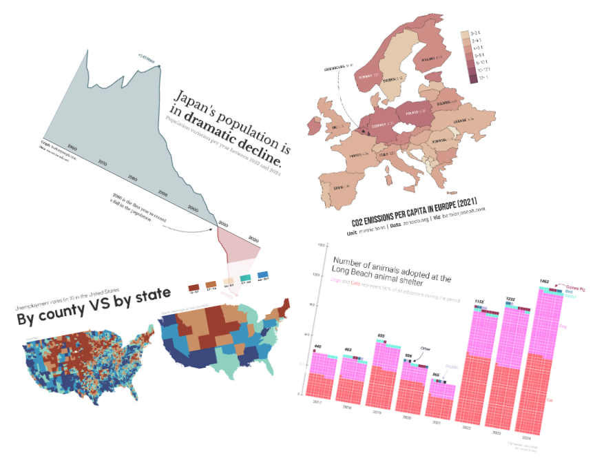
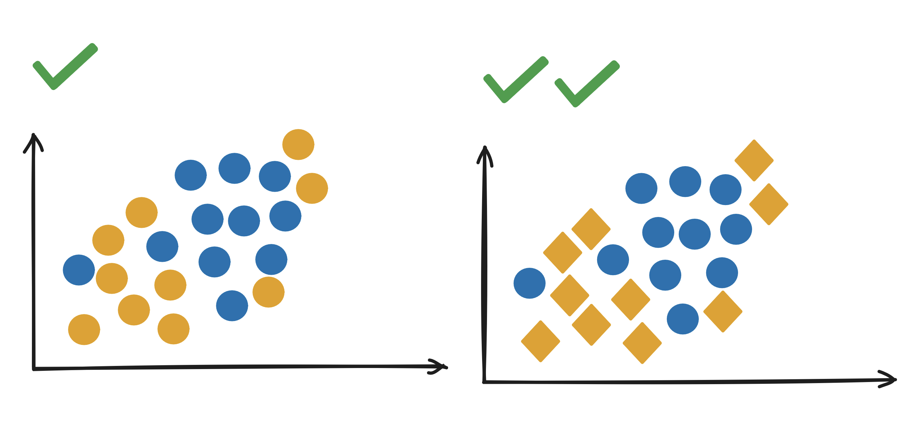
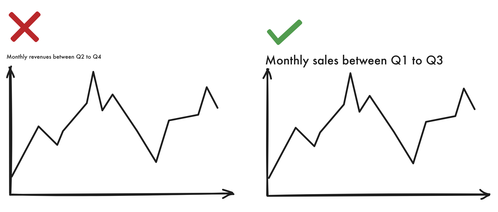
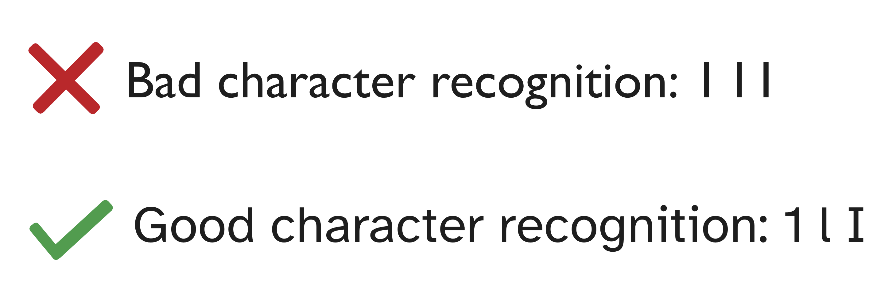

## About

 

:::: {.columns}

::: {.column width="30%"}
{.circle}

   *Joseph*

     

   <a href="https://barbierjoseph.com">barbierjoseph.com</a>

   <a href="https://ysunflower.com">ysunflower.com</a>

:::

::: {.column width="15%"}
:::

::: {.column width="50%"}

   
   **Consulting / open source**:
   
   data(viz), Typst, accessibility

   

:::

::::

## Digital accessibility

ensuring that people with disabilities can perceive, understand, navigate, and interact with digital content and services.

- visual: blindness, low vision, color blindness or light sensitivity
- auditive: deafness and hearing loss
- physical: difficulty using a mouse, touchscreen or keyboard
- neurological: dyslexia, motion sensitivity, etc

## Accessibility and data science

- accessibility of the tools we use: IDEs, Jupyter, spreadsheets, BI tools, documentation
- accessibility of the outputs we produce: dashboards, charts (static or interactive), PDFs, web reports, slides

## The goal

Make people autonomous, reliable and let them chose the tool they want not because of its accessibility features.

Problem is: accessibility rarely happens by default! which means we need to add intent to ensure it

# Accessibility in data visualization

## Color contrast

 

{width=100% fig-align="center"}

## Colorblind-friendly palette

 

{width=100% fig-align="center"}

## Colorblind-friendly palette + double encoding

 

{width=100% fig-align="center"}

## Fonts

 

{width=100% fig-align="center"}

## Fonts

 

{width=100% fig-align="center"}

## Fonts

 

{width=100% fig-align="center"}

 

Atkinson Hyperlegible

## Dashboards, interactive graph, web apps

- keyboard navigation
- visible focus
- no hover only effects

## Existing projects

- realcolor
- matplotalt
- verapdf/page

## *"nobody is my team has disabilities"*

- are you sure?
- can people with disabilities join your team?

## what you should do now

- check whether the required tools you used are accessible
- check whether what you produce is accessible

##

Thanks!

Want to know more?

::: {.nonincremental}
- let's chat!
- LinkedIn: Joseph Barbier
- email: `joseph@ysunflower.com`
- slides: [github.com/josephbarbierdarnal/talk](https://github.com/JosephBARBIERDARNAL/talk/)
:::

