## About

<br>

:::: {.columns}

::: {.column width="30%"}
{fig-alt="Portrait of Joseph Barbier." .circle}
<div style="font-size:1em;">
   *Joseph*

   <a href="https://ysunflower.com">ysunflower.com</a>

</div>
:::

::: {.column width="15%"}
:::

::: {.column width="50%"}
<div style="font-size: 1.2em;">
   
   **Consulting / open source**:
   
   data(viz), Typst, accessibility

   {fig-alt="Collage of maps, charts, and other data visualizations."}
</div>
:::

::::

## Digital accessibility

<br>

<div style="font-size: 1.8em;">
   
> *Ensuring that people with disabilities can **perceive**, **understand**, **navigate**, and **interact** with digital content/services/software/...*
   
</div>

<br>


<div style="display:grid; grid-template-columns:repeat(2, minmax(0, 1fr)); gap:0.5em; justify-items:center; align-items:center; margin-top:0.35em;">
  <svg role="img" aria-label="Visual accessibility" viewBox="0 0 64 64" width="4.5em" height="4.5em" fill="none" stroke="#107895" stroke-width="3" stroke-linecap="round" stroke-linejoin="round">
    <path d="M5 32s9-17 27-17 27 17 27 17-9 17-27 17S5 32 5 32Z"/>
    <circle cx="32" cy="32" r="8"/>
  </svg>
  <svg role="img" aria-label="Auditory accessibility" viewBox="0 0 64 64" width="4.5em" height="4.5em" fill="none" stroke="#107895" stroke-width="3" stroke-linecap="round" stroke-linejoin="round">
    <path d="M19 26a13 13 0 0 1 26 0c0 8-5 11-9 15-3 3-3 7-4 10-1 3-4 5-7 4-4-1-5-5-4-9 2-7 8-10 10-15 2-5-1-9-5-9-3 0-5 2-5 5"/>
    <path d="M32 37c3-3 6-5 6-10"/>
  </svg>
  <svg role="img" aria-label="Physical accessibility" viewBox="0 0 64 64" width="4.5em" height="4.5em" fill="none" stroke="#107895" stroke-width="3" stroke-linecap="round" stroke-linejoin="round">
    <path d="M24 32V15a4 4 0 0 1 8 0v15-20a4 4 0 0 1 8 0v20-16a4 4 0 0 1 8 0v19-11a4 4 0 0 1 8 0v17c0 11-7 19-18 19h-5c-6 0-10-3-14-8L9 39a4 4 0 0 1 6-5l9 8"/>
  </svg>
  <svg role="img" aria-label="Neurological accessibility" viewBox="0 0 64 64" width="4.5em" height="4.5em" fill="none" stroke="#107895" stroke-width="3" stroke-linecap="round" stroke-linejoin="round">
    <path d="M32 10c-4-5-13-4-15 3-7-1-12 6-9 12-6 4-5 13 1 16-2 7 4 13 11 12 3 7 12 7 15 1V14c0-2-1-3-3-4Z"/>
    <path d="M32 10c4-5 13-4 15 3 7-1 12 6 9 12 6 4 5 13-1 16 2 7-4 13-11 12-3 7-12 7-15 1"/>
    <path d="M20 20c5 1 7 5 6 9m-14 4c5-2 9 0 10 4m-4 10c4-3 8-3 11 0m15-27c-5 1-7 5-6 9m14 4c-5-2-9 0-10 4m4 10c-4-3-8-3-11 0"/>
  </svg>
</div>

## Digital accessibility

<br>

<div style="font-size: 1.6em;">

**Not just a good practice, a legal requirement!**

</div>

<br>

- **1990** — Americans with Disabilities Act (US)
- **2005** — French Disability Law (France)
- **2016** — Web Accessibility Directive (EU)
- **2025** — European Accessibility Act (EU, applicable since June)

<br>

> Non-compliance can result in lawsuits, financial penalties or market restrictions.

## Digital accessibility

<br>

<div style="font-size: 1.6em;">

- Less than **1% of PDFs** meet accessibility standards
- Less than **4.1% of web pages** meet accessibility standards

</div>

<br>
<br>
<br>
<br>
<br>
<br>
<br>
<br>
<br>
<br>

### References

- *PDF Trends 2026: the production, structure, and accessibility of 20,000,000 PDFs*, **PDF Association**
- *WebAIM Million: The 2026 report on the accessibility of the top 1,000,000 home pages*, **WebAIM**


## Accessibility and data science

<br><br>

:::: {.columns}

::: {.column width="45%"}

**Tools we use**: IDEs, notebooks, spreadsheets, BI tools, documentation

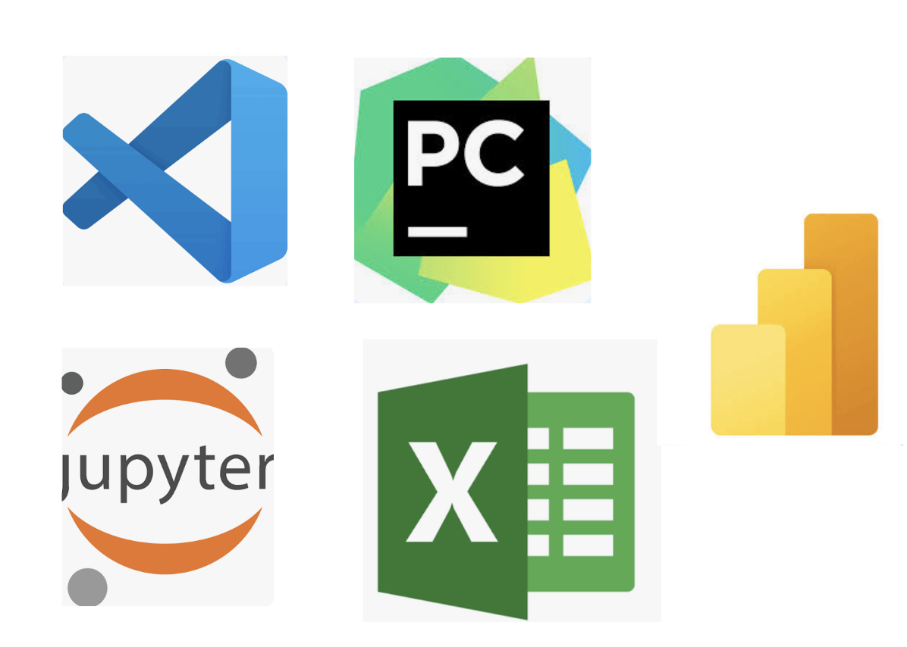{fig-alt="Logos of VS Code, PyCharm, Jupyter, Excel, and Power BI."}

:::

::: {.column width="10%"}
:::

::: {.column width="45%"}

**Outputs we produce**: dashboards, charts, PDFs, web reports, slides

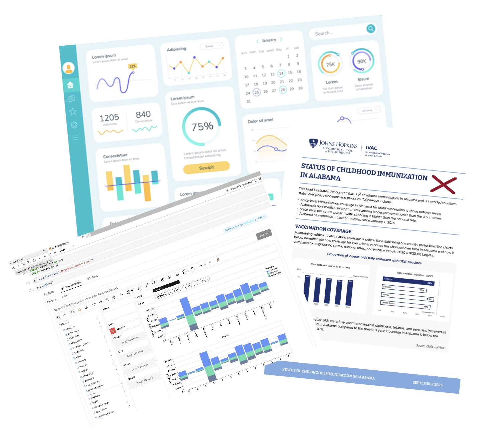{fig-alt="Collage of a dashboard, a Jupyter notebook with interactive bar charts, and a PDF report on childhood immunization."}

:::

::::

## Goal

<br>
<br>

<div style="font-size: 1.8em;">
   
> *Make people autonomous and reliable, and let them choose the tool they need, not because of its accessibility features.*

<br>
   
Problem is: accessibility rarely happens by default! Which means we need to **add intent** to ensure it.

</div>

##

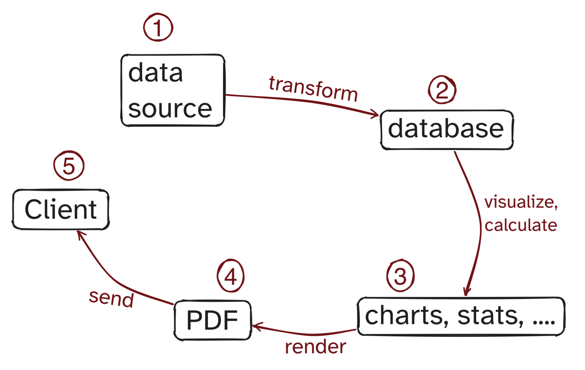{fig-alt="Diagram of a typical data workflow: (1) a data source is transformed into (2) a database, which is visualized and calculated into (3) charts and stats, rendered into (4) a PDF, and sent to (5) the client." width="90%"}

## 

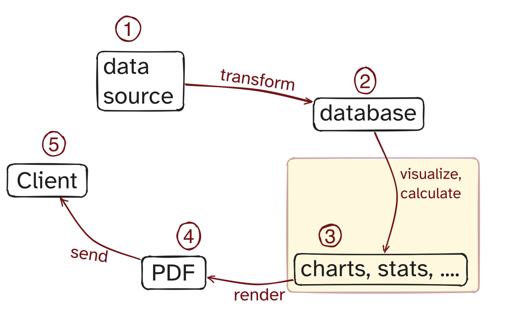{fig-alt="Same data workflow diagram, with step 3 (charts and stats) highlighted." width="90%"}

# Data visualization

## Color contrast

<br>

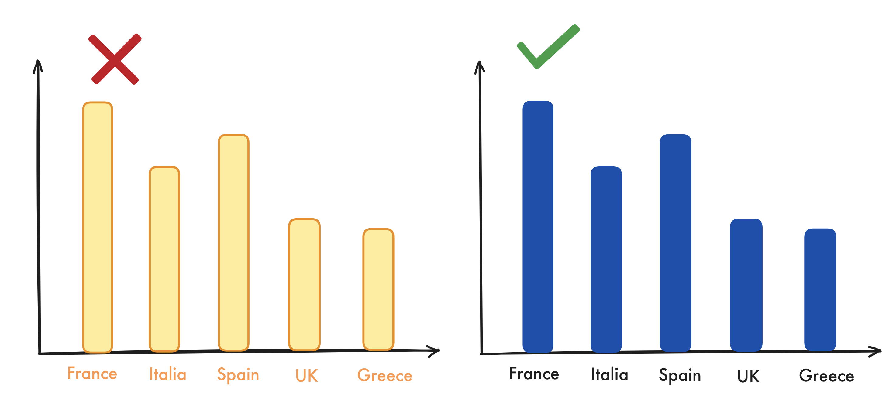{fig-alt="Two bar charts compare France, Italy, Spain, the UK, and Greece. The pale yellow bars are marked as hard to distinguish; dark blue bars provide stronger contrast." width=100% fig-align="center"}

<div style="display:flex; justify-content:center; align-items:center; gap:1.5em; margin-top:0.25em; font-size:0.9em;">
<div><span style="display:inline-block; width:0.8em; height:0.8em; background:#FCEDA3; vertical-align:middle;"></span> Yellow bars on white: <strong>1.18:1</strong></div>
<div><span style="display:inline-block; width:0.8em; height:0.8em; background:#204FA9; vertical-align:middle;"></span> Blue bars on white: <strong>7.63:1</strong></div>
</div>

## Color contrast

<br><br>

<div style="text-align:center;">
<div style="color:#B3B3B3; font-size:1.7em; font-weight:700; line-height:1.1;">Sample text</div>
<div style="font-size:1.25em; font-weight:700;">2.1:1</div>
</div>
<br>
<div style="border:8px solid #C00000; text-align:center;">
<div style="color:#777777; font-size:1.7em; font-weight:700; line-height:1.1;">Sample text</div>
<div style="font-size:1.25em; font-weight:700;">4.48:1</div>
</div>
<br>
<div style="border:8px solid #53b602; text-align:center;">
<div style="color:#595959; font-size:1.7em; font-weight:700; line-height:1.1;">Sample text</div>
<div style="font-size:1.25em; font-weight:700;">7:1</div>
</div>
<br>
<div style="text-align:center;">
<div style="color:#000000; font-size:1.7em; font-weight:700; line-height:1.1;">Sample text</div>
<div style="font-size:1.25em; font-weight:700;">21:1</div>
</div>

## Colorblindness

<center>

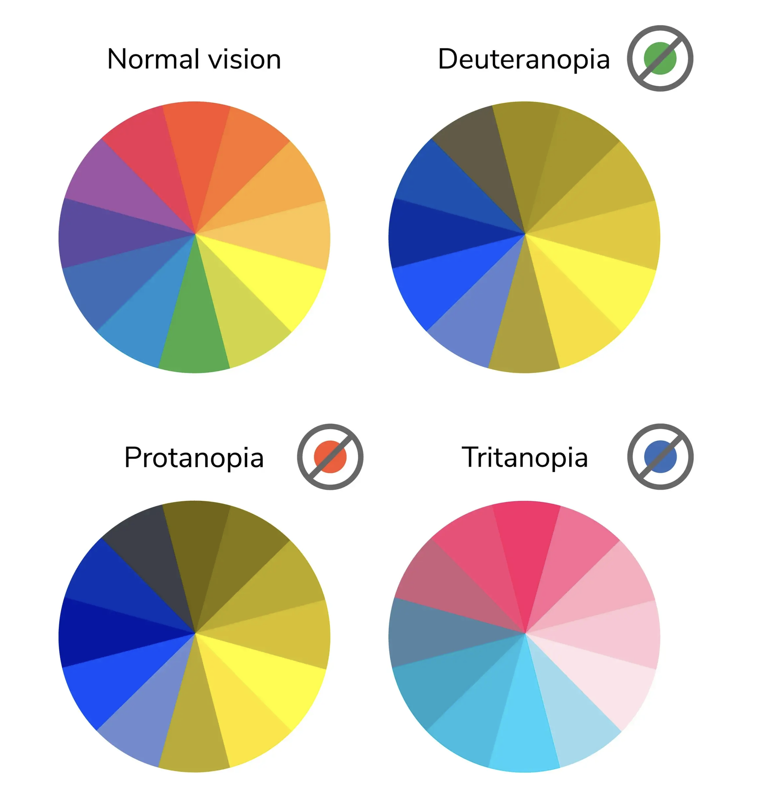{fig-alt="Four color wheels showing how the same colors look with normal vision, deuteranopia, protanopia, and tritanopia. With deuteranopia and protanopia, reds and greens become yellows and browns; with tritanopia, blues and yellows become teals and pinks." width="60%"}

</center>

## Colorblind-friendly palette

{fig-alt="Two scatterplots compare red and green points, which are difficult to distinguish for some viewers, with a colorblind-friendly blue and amber palette." width=80% fig-align="center"}

## Colorblind-friendly palette + double encoding

<br>

{fig-alt="Scatterplots use blue and amber colors, then add circle and diamond shapes so the groups can also be distinguished without color." width=100% fig-align="center"}

## Fonts

<br>

{fig-alt="Two line charts compare a tiny, hard-to-read label with a larger, clearer label." width=100% fig-align="center"}

## Fonts

<br>

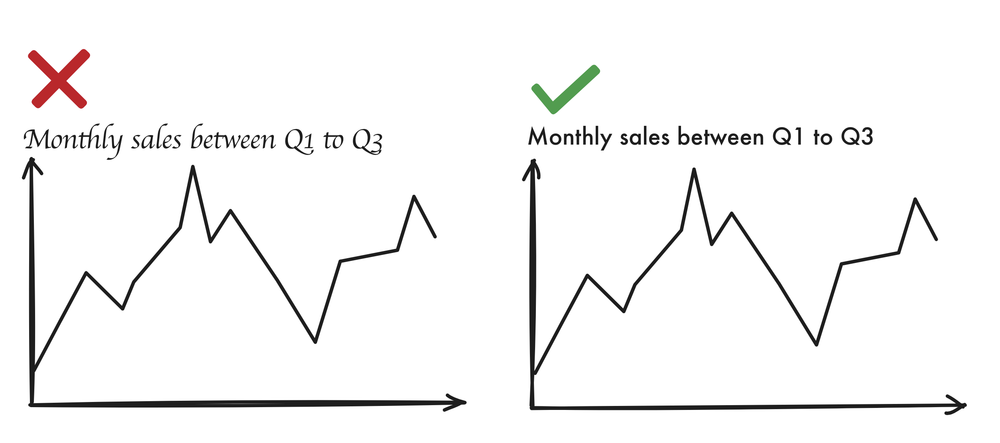{fig-alt="Two line charts compare a small italic label with a larger, more legible label." width=100% fig-align="center"}

## Fonts

<br>

{fig-alt="Text sample comparing letter recognition in two fonts, with the clearer character shapes marked as the better example." width=100% fig-align="center"}

<br>

<center><span style='font-weight: bold; font-family: "Atkinson Hyperlegible", sans-serif; font-size: 1.6em; background-color: black; color: white; padding: 18px 25px'>Atkinson Hyperlegible</span></center>

## 

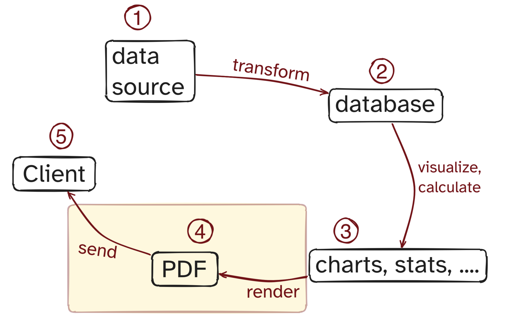{fig-alt="Same data workflow diagram, with steps 4 and 5 (rendering the PDF and sending it to the client) highlighted." width="90%"}

# **Documents & reports**:<br>PDF, HTML, Markdown, Word...

##

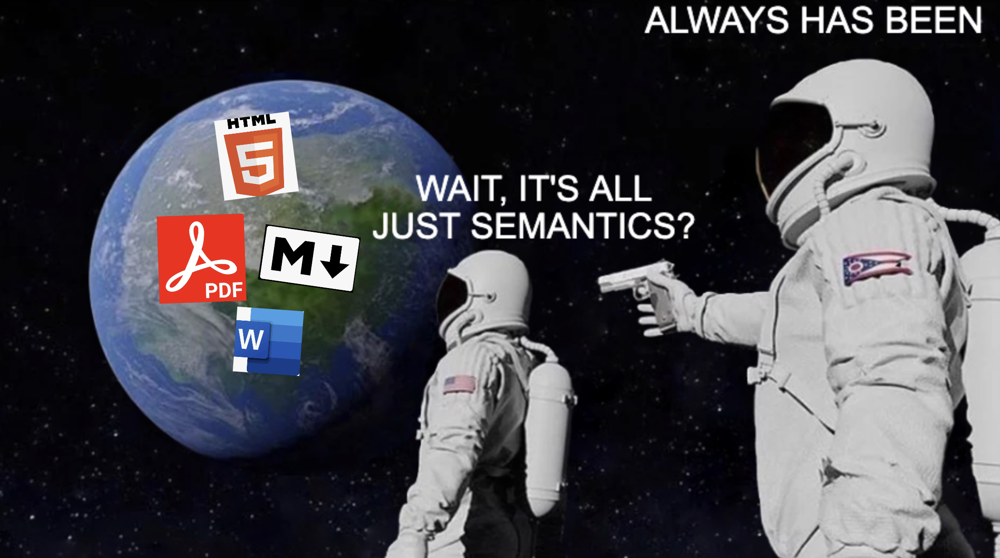{fig-alt="“Always has been” meme: an astronaut looks at Earth, covered with HTML, PDF, Markdown, and Word logos, and says “Wait, it's all just semantics?” A second astronaut, pointing a gun at them from behind, replies “Always has been.”"}

## Semantic structure

<br>

<div style="font-size: 1.7em;">

❌ Don't:


```md
# Title

### A subtitle

Lorem ipsum dolor sit amet, consectetur adipiscing elit, sed do
```

<br>

✅ Do: 

```md
# Title

## A subtitle

Lorem ipsum dolor sit amet, consectetur adipiscing elit, sed do
```

</div>

## Alternative text

<center></center>

<div style="font-size: 1.8em;">
   
> *"A brown bear standing upright in water, waving a paw."*
   
</div>

##

<br>
<br>

{fig-alt="Image of the words “This is not text”." width="50%"}

<br>
<br>

<div style="font-size: 3.2em; font-family: 'Atkinson Hyperlegible'; margin-left: 20px">
   
This is text

</div>

##

<br>
<br>

<div style="font-size: 2.5em;">

<h3>This is a heading</h3>

<br>

<span style="font-weight: 400; font-size: 1.20em; color: #107895;">This is not a heading</span>

</div>

## Dashboards, interactive charts, web apps

<video autoplay loop muted playsinline controls width="100%" aria-label="Screen recording demonstrating keyboard navigation of an interactive chart.">
  <source src="./keyboard-demo.mp4" type="video/mp4" />
</video>

# What's next?

## What's next?

<div style="font-size:1.4em;">

Accessibility can be viewed as an **engineering problem**!

- automate accessibility validation
- good vs. great accessibility
  
</div>

## What's next?

<br>

<div style="font-size: 1.2em; line-height: 2.2em;">

<center style="font-size:1.2em;">Accessibility audit!</center>

<br>
<br>
<br>

PDF: <a href="https://github.com/veraPDF/veraPDF-library"><svg aria-hidden="true" focusable="false" viewBox="0 0 16 16" width="0.9em" height="0.9em" style="vertical-align: -0.1em; margin-right: 0.2em; fill: currentColor;"><path d="M8 0C3.58 0 0 3.58 0 8c0 3.54 2.29 6.53 5.47 7.59.4.07.55-.17.55-.38 0-.19-.01-.82-.01-1.49-2.01.37-2.53-.49-2.69-.94-.09-.23-.48-.94-.82-1.13-.28-.15-.68-.52-.01-.53.63-.01 1.08.58 1.23.82.72 1.21 1.87.87 2.33.66.07-.52.28-.87.51-1.07-1.78-.2-3.64-.89-3.64-3.95 0-.87.31-1.59.82-2.15-.08-.2-.36-1.02.08-2.12 0 0 .67-.21 2.2.82.64-.18 1.32-.27 2-.27s1.36.09 2 .27c1.53-1.04 2.2-.82 2.2-.82.44 1.1.16 1.92.08 2.12.51.56.82 1.27.82 2.15 0 3.07-1.87 3.75-3.65 3.95.29.25.54.73.54 1.48 0 1.07-.01 1.93-.01 2.2 0 .21.15.46.55.38A8.01 8.01 0 0 0 16 8c0-4.42-3.58-8-8-8Z"/></svg>veraPDF/veraPDF-library</a>
<br>
HTML: <a href="https://github.com/dequelabs/axe-core"><svg aria-hidden="true" focusable="false" viewBox="0 0 16 16" width="0.9em" height="0.9em" style="vertical-align: -0.1em; margin-right: 0.2em; fill: currentColor;"><path d="M8 0C3.58 0 0 3.58 0 8c0 3.54 2.29 6.53 5.47 7.59.4.07.55-.17.55-.38 0-.19-.01-.82-.01-1.49-2.01.37-2.53-.49-2.69-.94-.09-.23-.48-.94-.82-1.13-.28-.15-.68-.52-.01-.53.63-.01 1.08.58 1.23.82.72 1.21 1.87.87 2.33.66.07-.52.28-.87.51-1.07-1.78-.2-3.64-.89-3.64-3.95 0-.87.31-1.59.82-2.15-.08-.2-.36-1.02.08-2.12 0 0 .67-.21 2.2.82.64-.18 1.32-.27 2-.27s1.36.09 2 .27c1.53-1.04 2.2-.82 2.2-.82.44 1.1.16 1.92.08 2.12.51.56.82 1.27.82 2.15 0 3.07-1.87 3.75-3.65 3.95.29.25.54.73.54 1.48 0 1.07-.01 1.93-.01 2.2 0 .21.15.46.55.38A8.01 8.01 0 0 0 16 8c0-4.42-3.58-8-8-8Z"/></svg>dequelabs/axe-core</a>
<br>
Markdown: <a href="https://github.com/DavidAnson/markdownlint"><svg aria-hidden="true" focusable="false" viewBox="0 0 16 16" width="0.9em" height="0.9em" style="vertical-align: -0.1em; margin-right: 0.2em; fill: currentColor;"><path d="M8 0C3.58 0 0 3.58 0 8c0 3.54 2.29 6.53 5.47 7.59.4.07.55-.17.55-.38 0-.19-.01-.82-.01-1.49-2.01.37-2.53-.49-2.69-.94-.09-.23-.48-.94-.82-1.13-.28-.15-.68-.52-.01-.53.63-.01 1.08.58 1.23.82.72 1.21 1.87.87 2.33.66.07-.52.28-.87.51-1.07-1.78-.2-3.64-.89-3.64-3.95 0-.87.31-1.59.82-2.15-.08-.2-.36-1.02.08-2.12 0 0 .67-.21 2.2.82.64-.18 1.32-.27 2-.27s1.36.09 2 .27c1.53-1.04 2.2-.82 2.2-.82.44 1.1.16 1.92.08 2.12.51.56.82 1.27.82 2.15 0 3.07-1.87 3.75-3.65 3.95.29.25.54.73.54 1.48 0 1.07-.01 1.93-.01 2.2 0 .21.15.46.55.38A8.01 8.01 0 0 0 16 8c0-4.42-3.58-8-8-8Z"/></svg>DavidAnson/markdownlint</a>
</div>


## Colorblindness simulators

<br>

<div style="font-size: 1.2em; line-height: 2.2em;">
R: <a href="https://github.com/clauswilke/colorblindr"><svg aria-hidden="true" focusable="false" viewBox="0 0 16 16" width="0.9em" height="0.9em" style="vertical-align: -0.1em; margin-right: 0.2em; fill: currentColor;"><path d="M8 0C3.58 0 0 3.58 0 8c0 3.54 2.29 6.53 5.47 7.59.4.07.55-.17.55-.38 0-.19-.01-.82-.01-1.49-2.01.37-2.53-.49-2.69-.94-.09-.23-.48-.94-.82-1.13-.28-.15-.68-.52-.01-.53.63-.01 1.08.58 1.23.82.72 1.21 1.87.87 2.33.66.07-.52.28-.87.51-1.07-1.78-.2-3.64-.89-3.64-3.95 0-.87.31-1.59.82-2.15-.08-.2-.36-1.02.08-2.12 0 0 .67-.21 2.2.82.64-.18 1.32-.27 2-.27s1.36.09 2 .27c1.53-1.04 2.2-.82 2.2-.82.44 1.1.16 1.92.08 2.12.51.56.82 1.27.82 2.15 0 3.07-1.87 3.75-3.65 3.95.29.25.54.73.54 1.48 0 1.07-.01 1.93-.01 2.2 0 .21.15.46.55.38A8.01 8.01 0 0 0 16 8c0-4.42-3.58-8-8-8Z"/></svg>clauswilke/colorblindr</a>
<br>
Python: <a href="https://github.com/y-sunflower/realcolor"><svg aria-hidden="true" focusable="false" viewBox="0 0 16 16" width="0.9em" height="0.9em" style="vertical-align: -0.1em; margin-right: 0.2em; fill: currentColor;"><path d="M8 0C3.58 0 0 3.58 0 8c0 3.54 2.29 6.53 5.47 7.59.4.07.55-.17.55-.38 0-.19-.01-.82-.01-1.49-2.01.37-2.53-.49-2.69-.94-.09-.23-.48-.94-.82-1.13-.28-.15-.68-.52-.01-.53.63-.01 1.08.58 1.23.82.72 1.21 1.87.87 2.33.66.07-.52.28-.87.51-1.07-1.78-.2-3.64-.89-3.64-3.95 0-.87.31-1.59.82-2.15-.08-.2-.36-1.02.08-2.12 0 0 .67-.21 2.2.82.64-.18 1.32-.27 2-.27s1.36.09 2 .27c1.53-1.04 2.2-.82 2.2-.82.44 1.1.16 1.92.08 2.12.51.56.82 1.27.82 2.15 0 3.07-1.87 3.75-3.65 3.95.29.25.54.73.54 1.48 0 1.07-.01 1.93-.01 2.2 0 .21.15.46.55.38A8.01 8.01 0 0 0 16 8c0-4.42-3.58-8-8-8Z"/></svg>y-sunflower/realcolor</a>
</div>

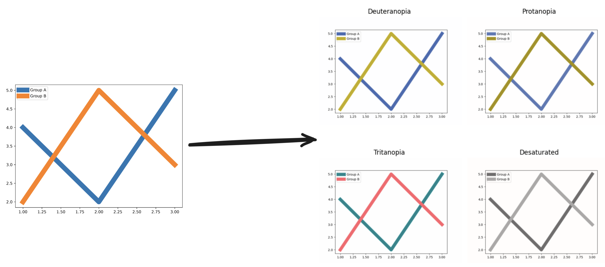{fig-alt="A line chart with two groups in blue and orange, with an arrow pointing to four simulated versions of it: deuteranopia, protanopia, tritanopia, and desaturated."}

## Alt text generators

<br>

<div style="font-size: 1.2em; line-height: 2.2em;">
R: <a href="https://github.com/y-sunflower/ggalttext"><svg aria-hidden="true" focusable="false" viewBox="0 0 16 16" width="0.9em" height="0.9em" style="vertical-align: -0.1em; margin-right: 0.2em; fill: currentColor;"><path d="M8 0C3.58 0 0 3.58 0 8c0 3.54 2.29 6.53 5.47 7.59.4.07.55-.17.55-.38 0-.19-.01-.82-.01-1.49-2.01.37-2.53-.49-2.69-.94-.09-.23-.48-.94-.82-1.13-.28-.15-.68-.52-.01-.53.63-.01 1.08.58 1.23.82.72 1.21 1.87.87 2.33.66.07-.52.28-.87.51-1.07-1.78-.2-3.64-.89-3.64-3.95 0-.87.31-1.59.82-2.15-.08-.2-.36-1.02.08-2.12 0 0 .67-.21 2.2.82.64-.18 1.32-.27 2-.27s1.36.09 2 .27c1.53-1.04 2.2-.82 2.2-.82.44 1.1.16 1.92.08 2.12.51.56.82 1.27.82 2.15 0 3.07-1.87 3.75-3.65 3.95.29.25.54.73.54 1.48 0 1.07-.01 1.93-.01 2.2 0 .21.15.46.55.38A8.01 8.01 0 0 0 16 8c0-4.42-3.58-8-8-8Z"/></svg>y-sunflower/ggalttext</a>
<br>
Python: <a href="https://github.com/make4all/matplotalt"><svg aria-hidden="true" focusable="false" viewBox="0 0 16 16" width="0.9em" height="0.9em" style="vertical-align: -0.1em; margin-right: 0.2em; fill: currentColor;"><path d="M8 0C3.58 0 0 3.58 0 8c0 3.54 2.29 6.53 5.47 7.59.4.07.55-.17.55-.38 0-.19-.01-.82-.01-1.49-2.01.37-2.53-.49-2.69-.94-.09-.23-.48-.94-.82-1.13-.28-.15-.68-.52-.01-.53.63-.01 1.08.58 1.23.82.72 1.21 1.87.87 2.33.66.07-.52.28-.87.51-1.07-1.78-.2-3.64-.89-3.64-3.95 0-.87.31-1.59.82-2.15-.08-.2-.36-1.02.08-2.12 0 0 .67-.21 2.2.82.64-.18 1.32-.27 2-.27s1.36.09 2 .27c1.53-1.04 2.2-.82 2.2-.82.44 1.1.16 1.92.08 2.12.51.56.82 1.27.82 2.15 0 3.07-1.87 3.75-3.65 3.95.29.25.54.73.54 1.48 0 1.07-.01 1.93-.01 2.2 0 .21.15.46.55.38A8.01 8.01 0 0 0 16 8c0-4.42-3.58-8-8-8Z"/></svg>make4all/matplotalt</a>
</div>

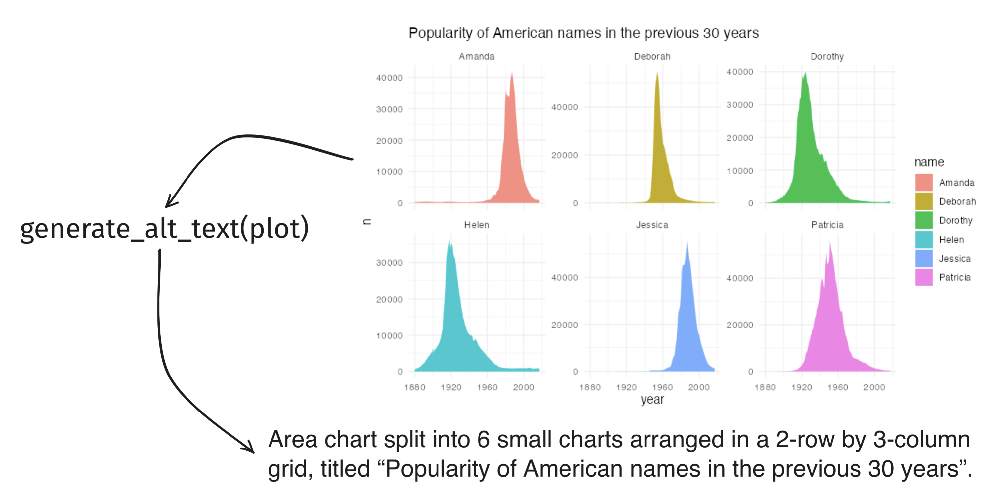{fig-alt="The code generate_alt_text(plot) applied to a faceted area chart titled “Popularity of American names in the previous 30 years” returns the description: “Area chart split into 6 small charts arranged in a 2-row by 3-column grid, titled ‘Popularity of American names in the previous 30 years’.”"}

## Screen reader testing

<br>

<div style="font-size: 1.2em; line-height: 2.2em;">
Windows: <a href="https://github.com/nvaccess/nvda"><svg aria-hidden="true" focusable="false" viewBox="0 0 16 16" width="0.9em" height="0.9em" style="vertical-align: -0.1em; margin-right: 0.2em; fill: currentColor;"><path d="M8 0C3.58 0 0 3.58 0 8c0 3.54 2.29 6.53 5.47 7.59.4.07.55-.17.55-.38 0-.19-.01-.82-.01-1.49-2.01.37-2.53-.49-2.69-.94-.09-.23-.48-.94-.82-1.13-.28-.15-.68-.52-.01-.53.63-.01 1.08.58 1.23.82.72 1.21 1.87.87 2.33.66.07-.52.28-.87.51-1.07-1.78-.2-3.64-.89-3.64-3.95 0-.87.31-1.59.82-2.15-.08-.2-.36-1.02.08-2.12 0 0 .67-.21 2.2.82.64-.18 1.32-.27 2-.27s1.36.09 2 .27c1.53-1.04 2.2-.82 2.2-.82.44 1.1.16 1.92.08 2.12.51.56.82 1.27.82 2.15 0 3.07-1.87 3.75-3.65 3.95.29.25.54.73.54 1.48 0 1.07-.01 1.93-.01 2.2 0 .21.15.46.55.38A8.01 8.01 0 0 0 16 8c0-4.42-3.58-8-8-8Z"/></svg>nvaccess/nvda</a>
<br>
Linux: <a href="https://gitlab.gnome.org/GNOME/orca"><svg aria-hidden="true" focusable="false" viewBox="0 0 16 16" width="0.9em" height="0.9em" style="vertical-align: -0.1em; margin-right: 0.2em; fill: currentColor;"><path d="M8 0C3.58 0 0 3.58 0 8c0 3.54 2.29 6.53 5.47 7.59.4.07.55-.17.55-.38 0-.19-.01-.82-.01-1.49-2.01.37-2.53-.49-2.69-.94-.09-.23-.48-.94-.82-1.13-.28-.15-.68-.52-.01-.53.63-.01 1.08.58 1.23.82.72 1.21 1.87.87 2.33.66.07-.52.28-.87.51-1.07-1.78-.2-3.64-.89-3.64-3.95 0-.87.31-1.59.82-2.15-.08-.2-.36-1.02.08-2.12 0 0 .67-.21 2.2.82.64-.18 1.32-.27 2-.27s1.36.09 2 .27c1.53-1.04 2.2-.82 2.2-.82.44 1.1.16 1.92.08 2.12.51.56.82 1.27.82 2.15 0 3.07-1.87 3.75-3.65 3.95.29.25.54.73.54 1.48 0 1.07-.01 1.93-.01 2.2 0 .21.15.46.55.38A8.01 8.01 0 0 0 16 8c0-4.42-3.58-8-8-8Z"/></svg>GNOME/orca</a>
<br>
macOS / iOS: <a href="https://www.apple.com/accessibility/vision/">VoiceOver</a> (built-in)
<br>
Android: <a href="https://github.com/google/talkback">TalkBack</a> (built-in)
</div>

<br>
<br>

<center style="font-size: 1.4em;">

**Passing an accessibility audit doesn't guarantee accessibility!**

</center>

## AI & accessibility

<center>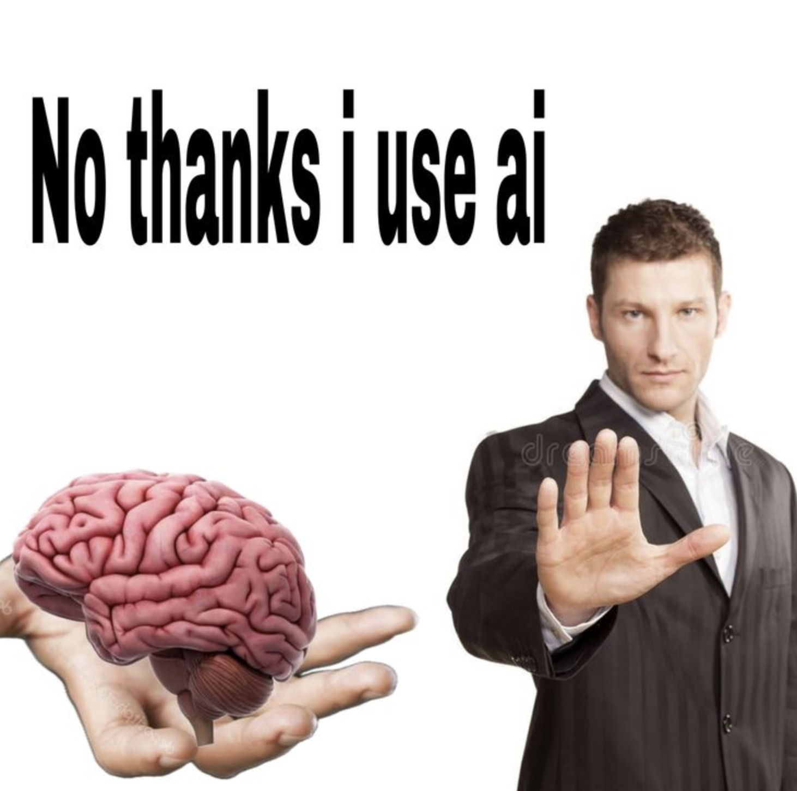</center>

<a href="https://github.com/y-sunflower/data-science-accessibility"><svg aria-hidden="true" focusable="false" viewBox="0 0 16 16" width="0.9em" height="0.9em" style="vertical-align: -0.1em; margin-right: 0.2em; fill: currentColor;"><path d="M8 0C3.58 0 0 3.58 0 8c0 3.54 2.29 6.53 5.47 7.59.4.07.55-.17.55-.38 0-.19-.01-.82-.01-1.49-2.01.37-2.53-.49-2.69-.94-.09-.23-.48-.94-.82-1.13-.28-.15-.68-.52-.01-.53.63-.01 1.08.58 1.23.82.72 1.21 1.87.87 2.33.66.07-.52.28-.87.51-1.07-1.78-.2-3.64-.89-3.64-3.95 0-.87.31-1.59.82-2.15-.08-.2-.36-1.02.08-2.12 0 0 .67-.21 2.2.82.64-.18 1.32-.27 2-.27s1.36.09 2 .27c1.53-1.04 2.2-.82 2.2-.82.44 1.1.16 1.92.08 2.12.51.56.82 1.27.82 2.15 0 3.07-1.87 3.75-3.65 3.95.29.25.54.73.54 1.48 0 1.07-.01 1.93-.01 2.2 0 .21.15.46.55.38A8.01 8.01 0 0 0 16 8c0-4.42-3.58-8-8-8Z"/></svg>y-sunflower/data-science-accessibility</a>

##

<div style="display: flex; justify-content: center; font-size: 3em;">
Thanks!
</div>

Want to know more?


::: {.nonincremental}
- let's chat!
- LinkedIn: Joseph Barbier
- email: `joseph@ysunflower.com`
- slides: [github.com/josephbarbierdarnal/talk](https://github.com/JosephBARBIERDARNAL/talk/)
:::

<center></center>
