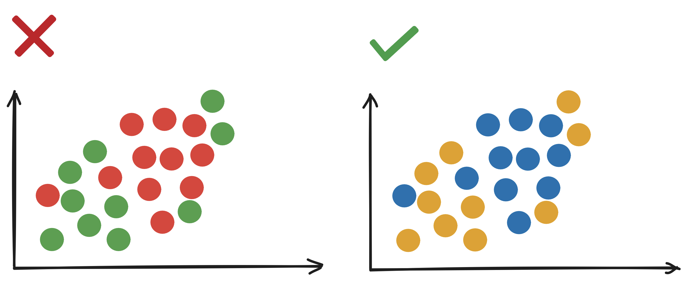
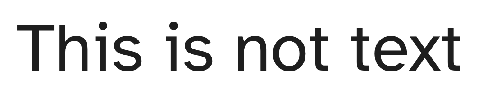

## About

<br>

:::: {.columns}

::: {.column width="30%"}
{fig-alt="Portrait of Joseph Barbier smiling and resting his cheek on one hand." .circle}
<div style="font-size:1em;">
   *Joseph*

   <a href="https://ysunflower.com">ysunflower.com</a>

</div>
:::

::: {.column width="15%"}
:::

::: {.column width="50%"}
<div style="font-size: 1.2em;">
   
   **Consulting / open source**:
   
   data(viz), Typst, accessibility

   {fig-alt="Collage of maps, charts, and other data visualizations."}
</div>
:::

::::

## Digital accessibility

ensuring that people with disabilities can perceive, understand, navigate, and interact with digital content and services.

- visual: blindness, low vision, color blindness or light sensitivity
- auditive: deafness and hearing loss
- physical: difficulty using a mouse, touchscreen or keyboard
- neurological: dyslexia, motion sensitivity, etc

## Accessibility and data science

- accessibility of the tools we use: IDEs, notebooks, spreadsheets, BI tools, documentation
- accessibility of the outputs we produce: dashboards, charts (static or interactive), PDFs, web reports, slides

## The goal

Make people autonomous, reliable and let them chose the tool they want not because of its accessibility features.

Problem is: accessibility rarely happens by default! which means we need to add intent to ensure it

# Accessibility in data visualization

## Color contrast

<br>

{fig-alt="Two bar charts compare France, Italy, Spain, the UK, and Greece. The pale yellow bars are marked as hard to distinguish; dark blue bars provide stronger contrast." width=100% fig-align="center"}

## Colorblind-friendly palette

<br>

{fig-alt="Two scatterplots compare red and green points, which are difficult to distinguish for some viewers, with a colorblind-friendly blue and amber palette." width=100% fig-align="center"}

## Colorblind-friendly palette + double encoding

<br>

{fig-alt="Scatterplots use blue and amber colors, then add circle and diamond shapes so the groups can also be distinguished without color." width=100% fig-align="center"}

## Fonts

<br>

{fig-alt="Two line charts compare a tiny, hard-to-read label with a larger, clearer label." width=100% fig-align="center"}

## Fonts

<br>

{fig-alt="Two line charts compare a small italic label with a larger, more legible label." width=100% fig-align="center"}

## Fonts

<br>

{fig-alt="Text sample comparing letter recognition in two fonts, with the clearer character shapes marked as the better example." width=100% fig-align="center"}

<br>

<center><span style='weight: bold; font-family: "Atkinson Hyperlegible", sans-serif; font-size: 1.6em; background-color: black; color: white; padding: 18px 25px'>Atkinson Hyperlegible</span></center>

# **Documents & reports**:<br>PDF, HTML, docx, pptx, ...

## Semantic structure

<br>

<div style="font-size: 2.1em;">


```md
# Title

### A subtitle

Lorem ipsum dolor sit amet, consectetur adipiscing elit, sed do
eiusmod tempor incididunt ut labore et dolore magna aliqua. Ut
enim ad minim veniam, quis nostrud exercitation ullamco laboris nisi.
```

<br>

```md
# Title

## A subtitle

Lorem ipsum dolor sit amet, consectetur adipiscing elit, sed do
eiusmod tempor incididunt ut labore et dolore magna aliqua. Ut
enim ad minim veniam, quis nostrud exercitation ullamco laboris nisi.
```

</div>

## Reading order

## Alternative text

<center></center>

<div style="font-size: 1.8em;">
   
> *"A brown bear standing upright in water, waving a paw."*
   
</div>

##

<br>
<br>

{width="50%"}

<br>
<br>

<div style="font-size: 3.2em; font-family: 'Atkinson Hyperlegible'; margin-left: 20px">
   
This is text

</div>

##

<br>
<br>

<div style="font-size: 2.5em;">

<h3>This is an heading</h3>

<br>

<span style="font-style: italic; font-weight: 400; font-size: 1.20em; color: #107895;">This is not an heading</span>

</div>

## Dashboards, interactive charts, web apps

- keyboard navigation
- visible focus
- no hover only effects

## Existing projects

- realcolor
- matplotalt
- verapdf/page

## *"nobody is my team has disabilities"*

- are you sure?
- can people with disabilities join your team?

## what you should do now

accessibility in a lot of small, easy-to-fix things!

- check whether the required tools you used are accessible
- check whether what you produce is accessible

##

<div style="display: flex; justify-content: center; font-size: 3em;">
Thanks!
</div>

Want to know more?


::: {.nonincremental}
- let's chat!
- LinkedIn: Joseph Barbier
- email: `joseph@ysunflower.com`
- slides: [github.com/josephbarbierdarnal/talk](https://github.com/JosephBARBIERDARNAL/talk/)
:::

<center></center>
