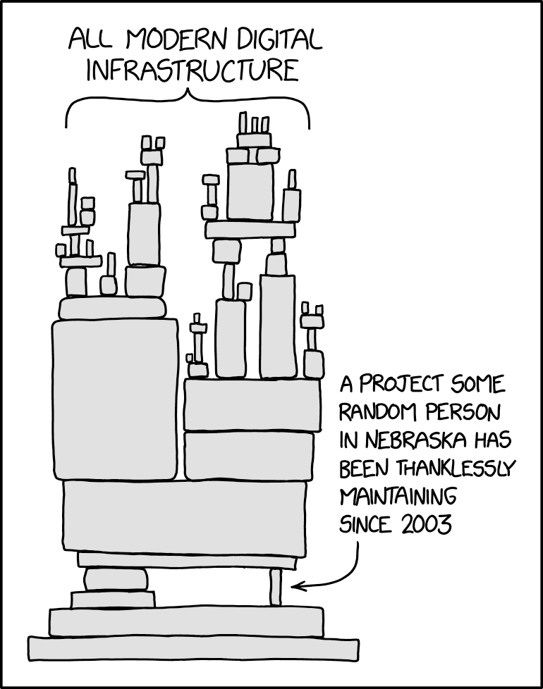
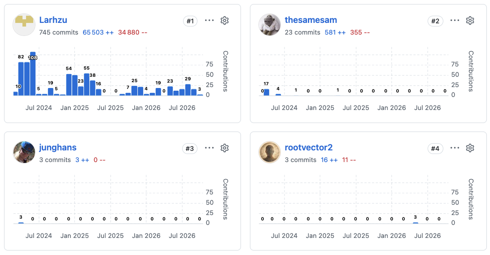

## Définitions

 

<table>
<caption class="sr-only">Comparaison des droits selon le type de logiciel.</caption>
<thead>
<tr><th scope="col">Type de logiciel</th><th scope="col">Lire le code</th><th scope="col">Modifier</th><th scope="col">Redistribuer</th><th scope="col">Usage commercial</th></tr>
</thead>
<tbody>
<tr><th scope="row">Logiciel libre</th><td>Oui</td><td>Oui</td><td>Oui</td><td>Oui</td></tr>
<tr><th scope="row">Open source</th><td>Oui</td><td>Oui</td><td>Oui</td><td>Oui</td></tr>
<tr><th scope="row">« Ouvert »</th><td>Oui</td><td>Partiellement</td><td>Partiellement</td><td>Non</td></tr>
<tr><th scope="row">Propriétaire</th><td>Non</td><td>Non</td><td>Non</td><td>Payant</td></tr>
</tbody>
</table>

 

*"Libre et open source, c'est pareil ?"* → **Presque**

## Libre vs open source

 

:::: {.columns}
::: {.column width="50%"}

### Logiciel libre

- **1983** : Richard Stallman, projet GNU
- Une question **éthique**
- 4 libertés : exécuter, étudier, modifier, partager
- Licences **copyleft** (GPL) : si tu redistribues, tu partages

 

> *"Free as in free speech, not as in free beer"*

:::
::: {.column width="50%"}

### Open source

- **1998** : Open Source Initiative (OSI)
- Une question **pragmatique**
- Un terme pensé pour convaincre les entreprises
- Licences **permissives** (MIT, Apache) : fais ce que tu veux

 

> *"Given enough eyeballs, all bugs are shallow"* - Eric S. Raymond

:::
::::

 

::: {.fragment}
En pratique : **les mêmes logiciels**, pas les mêmes arguments.
:::

## "Ouvert" : la zone grise

 

On voit le code... mais on ne peut pas en faire un concurrent.

 

<table>
<caption class="sr-only">Exemples de changements de licence et de leurs conséquences.</caption>
<thead>
<tr><th scope="col">Projet</th><th scope="col">Licence avant</th><th scope="col">Licence après</th><th scope="col">Réponse</th><th scope="col">Retour ?</th></tr>
</thead>
<tbody>
<tr><th scope="row">MongoDB (2018)</th><td>AGPL</td><td>SSPL</td><td>Clone AWS DocumentDB</td><td>Non</td></tr>
<tr><th scope="row">Elasticsearch (2021)</th><td>Apache 2.0</td><td>SSPL / Elastic License</td><td>Fork OpenSearch</td><td>AGPL (2024)</td></tr>
<tr><th scope="row">Terraform (2023)</th><td>MPL</td><td>BSL</td><td>Fork OpenTofu</td><td>Non (racheté par IBM)</td></tr>
<tr><th scope="row">Redis (2024)</th><td>BSD</td><td>RSAL / SSPL</td><td>Fork Valkey</td><td>AGPL (2025)</td></tr>
</tbody>
</table>

 

## Qui utilise l'open source ?

 

:::: {.columns}
::: {.column width="25%"}
::: {.big-number}
96%
:::
des logiciels commerciaux contiennent de l'open source
:::
::: {.column width="25%"}
::: {.big-number}
100%
:::
des 500 plus gros supercalculateurs tournent sous Linux
:::
::: {.column width="25%"}
::: {.big-number}
~70%
:::
des smartphones dans le monde (Android)
:::
::: {.column width="25%"}
::: {.big-number}
8 800 Md$
:::
pour tout réécrire si l'open source n'existait pas
:::
::::

 
 

::: {.fragment}
- Tous les langages de programmation et leurs packages
- Toutes les technologies autour de l'IA
- VLC, Firefox, Blender, LibreOffice...
:::

## Qui utilise l'open source ?

 

::: {.big-number}
96% de la valeur
:::

est produite par **5% des développeurs**

 
 

::: {.source}
Hoffmann, Nagle & Zhou, *The Value of Open Source Software*, Harvard Business School (2024)
:::

## Qui décide ?

 

:::: {.columns}
::: {.column width="40%"}

### Big tech

 

- **Google**: Android, Chromium, TensorFlow...
- **Microsoft**: TypeScript, VS Code, ...
- **Meta**: PyTorch, React, ...

Rachats récents:

- **OpenAI**: Astral
- **Anthropic**: Bun
- **IBM**: Red Hat
- **Cloudflare**: VoidZero

::: 
::: {.column width="60%"}

### Et les autres

:::
::::

## xz utils

 

- Environ ~100 millions d'ordinateurs qui l'utilisent
- Un seul mainteneur, **Lasse Colin**
- En 2022: *"I haven't lost interest but my ability to care has been fairly limited mostly due to **longterm mental health issues** but also due to some other things. Recently I've worked off-list a bit with [Jia Tan]{.red} on XZ Utils and perhaps he will have a **bigger role in the future**, we'll see."*
- Collaboration pendant ~2 ans
- CVSS 10

{fig-alt="Graphiques des contributions à un dépôt GitHub : un contributeur a effectué beaucoup plus de commits que les trois autres." width="500"}

- Recommandation : *"L'attaque informatique la plus sophistiquée de l'Histoire, Micode"*

## IA et modèles ouverts

 

Un modèle d'IA, c'est :

- des **données** d'entraînement
- du **code** d'entraînement
- des millions de $ de calcul
- des **poids** (le fichier final)

 

:::: {.columns}
::: {.column width="50%"}
### Logiciel

Code source → compilation → **binaire**
:::
::: {.column width="50%"}
### IA

Données + code → entraînement → **poids**
:::
::::

 

→ Publier les poids sans le reste, c'est publier **un binaire sans le code source**.

## Open source ou "open weights" ?

 

<table>
<caption class="sr-only">Comparaison de l’ouverture des poids, du code et des données de plusieurs modèles.</caption>
<thead>
<tr><th scope="col">Modèle</th><th scope="col">Poids ouverts</th><th scope="col">Code ouvert</th><th scope="col">Données ouvertes</th><th scope="col">Licence</th></tr>
</thead>
<tbody>
<tr><th scope="row">GPT-5, Claude, Gemini</th><td>Non</td><td>Non</td><td>Non</td><td>Propriétaire (API)</td></tr>
<tr><th scope="row">Llama (Meta)</th><td>Oui</td><td>Partiellement</td><td>Non</td><td>Llama License (max 700M utilisateurs)</td></tr>
<tr><th scope="row">DeepSeek R1</th><td>Oui</td><td>Partiellement</td><td>Non</td><td>MIT</td></tr>
<tr><th scope="row">Qwen, Mistral, gpt-oss</th><td>Oui</td><td>Partiellement</td><td>Non</td><td>Apache 2.0 (en général)</td></tr>
<tr><th scope="row">OLMo (Ai2)</th><td>Oui</td><td>Oui</td><td>Oui</td><td>Apache 2.0</td></tr>
</tbody>
</table>

 

La quasi-totalité des modèles dits "open source" sont en fait **open weights**.

*Selon la définition de l'OSI (2024), Llama n'est pas open source.*

## Pourquoi c'est important ?

 

- **Confidentialité** : faire tourner un modèle en local sans envoyer ses données
- **Souveraineté** : ne pas dépendre de 3 entreprises américaines
- **Recherche** : on ne peut pas étudier ce qu'on ne peut pas ouvrir
- **Reproductibilité** : modèle inutilisable au bout de quelques années
- **Prix** : la concurrence des modèles ouverts fait baisser les prix

 

- **Janvier 2025** : DeepSeek publie R1 en MIT

  - Nvidia perd **~600 milliards $** en bourse en une journée

- **Octobre 2026** : OpenAI supprime GPT 3.5 de ses services

## Science et logiciel libre

 

La science moderne tourne sur du logiciel libre :

 

:::: {.columns}
::: {.column width="33%"}
### 2016

Ondes gravitationnelles (LIGO)

*NumPy, SciPy, Matplotlib*
:::
::: {.column width="33%"}
### 2019

Première image d'un trou noir

*NumPy, Matplotlib, Astropy*
:::
::: {.column width="33%"}
### 2024

Prix Nobel de chimie (AlphaFold)

*Code publié sous Apache 2.0*
:::
::::

 
 
 

Et dans les labos : R, Python, Jupyter, Quarto/R Markdown, LaTeX...

## Quand la science dépend d'un logiciel fermé

 

Excel transforme automatiquement certains noms de gènes en dates :

 

`SEPT1` → [1-Sep]{.red} &nbsp;&nbsp;&nbsp; `MARCH1` → [1-Mar]{.red}

 

- **~20%** des articles de génomique avec des fichiers Excel sont touchés (Ziemann et al., 2016)
- On ne peut pas corriger Excel : ce n'est pas notre code

- **2020** : la communauté scientifique **renomme 27 gènes** (`SEPT1` → `SEPTIN1`)
- **2023** : Microsoft ajoute enfin une option pour désactiver la conversion

 

Avec un logiciel propriétaire, c'est **la science qui s'adapte au logiciel**.

## Reproductibilité

 

Un résultat scientifique = **données** + **code** + **environnement**

 

:::: {.columns}
::: {.column width="50%"}

### Logiciel propriétaire

- SAS, SPSS, Stata, MATLAB...
- Reproductible... **si on paie la licence**
- Et si la version existe encore

:::
::: {.column width="50%"}

### Logiciel libre

- R, Python, Julia...
- Reproductible par **n'importe qui**
- Code archivé pour toujours ([Software Heritage]{.green}, Inria)

:::
::::

 

- Plan national pour la science ouverte (2021 - 2024)
- Stratégie de science ouverte (2026 – 2033)

