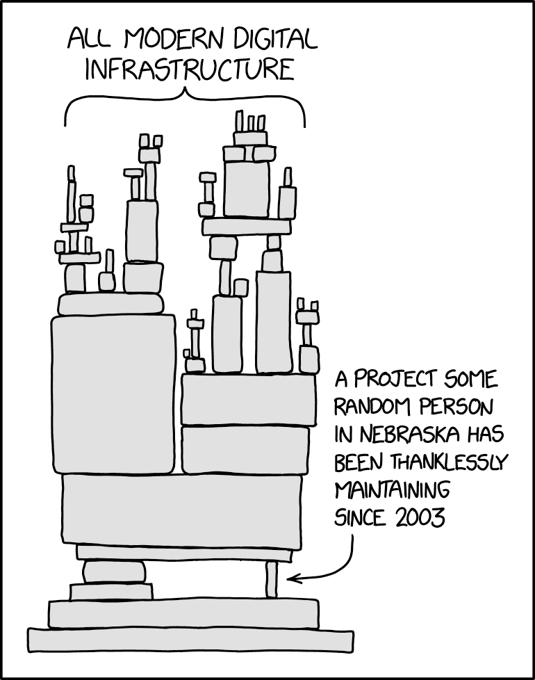
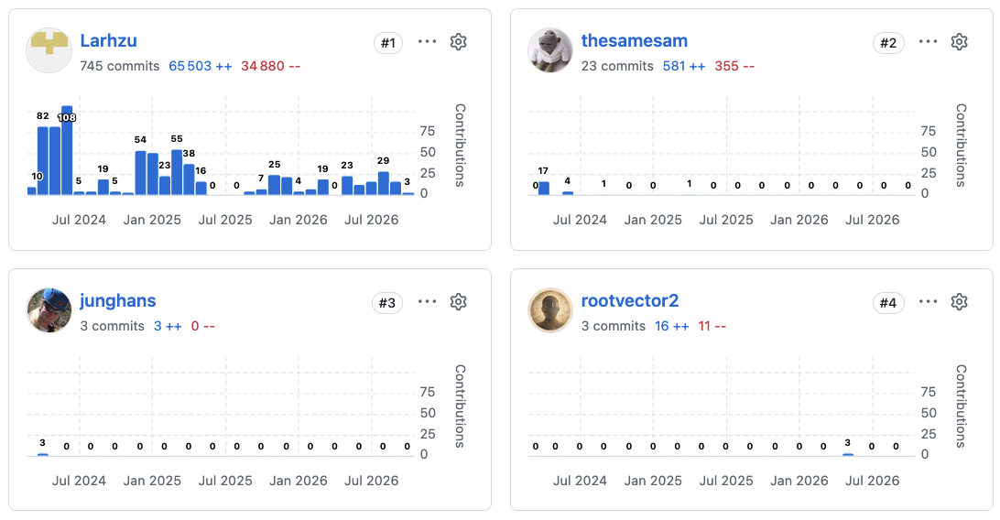

## Définitions

 

| | Lire le code | Modifier | Redistribuer | Usage commercial |
|---|:---:|:---:|:---:|:---:|
| **Logiciel libre** | ✅ | ✅ | ✅ | ✅ |
| **Open source** | ✅ | ✅ | ✅ | ✅ |
| **"Ouvert"** | ✅ | ⚠️ | ⚠️ | ❌ |
| **Propriétaire** | ❌ | ❌ | ❌ | 💰 |

 

*"Libre et open source, c'est pareil ?"* → **Presque**

## Libre vs open source

 

:::: {.columns}
::: {.column width="50%"}

### Logiciel libre

- **1983** : Richard Stallman, projet GNU
- Une question **éthique**
- 4 libertés : exécuter, étudier, modifier, partager
- Licences **copyleft** (GPL) : si tu redistribues, tu partages

 

> *"Free as in free speech, not as in free beer"*

:::
::: {.column width="50%"}

### Open source

- **1998** : Open Source Initiative (OSI)
- Une question **pragmatique**
- Un terme pensé pour convaincre les entreprises
- Licences **permissives** (MIT, Apache) : fais ce que tu veux

 

> *"Given enough eyeballs, all bugs are shallow"* - Eric S. Raymond

:::
::::

 

::: {.fragment}
En pratique : **les mêmes logiciels**, pas les mêmes arguments.
:::

## "Ouvert" : la zone grise

 

On voit le code... mais on ne peut pas en faire un concurrent.

 

| Projet | Avant | Après | Réponse | Retour ? |
|---|---|---|---|---|
| **MongoDB** (2018) | AGPL | SSPL | Clone AWS DocumentDB | ❌ |
| **Elasticsearch** (2021) | Apache 2.0 | SSPL / Elastic License | Fork [OpenSearch]{.green} | AGPL (2024) |
| **Terraform** (2023) | MPL | BSL | Fork [OpenTofu]{.green} | ❌ (racheté par IBM) |
| **Redis** (2024) | BSD | RSAL / SSPL | Fork [Valkey]{.green} | AGPL (2025) |

 

## Qui utilise l'open source ?

 

:::: {.columns}
::: {.column width="25%"}
::: {.big-number}
96%
:::
des logiciels commerciaux contiennent de l'open source
:::
::: {.column width="25%"}
::: {.big-number}
100%
:::
des 500 plus gros supercalculateurs tournent sous Linux
:::
::: {.column width="25%"}
::: {.big-number}
~70%
:::
des smartphones dans le monde (Android)
:::
::: {.column width="25%"}
::: {.big-number}
8 800 Md$
:::
pour tout réécrire si l'open source n'existait pas
:::
::::

 
 

::: {.fragment}
- Tous les langages de programmation et leurs packages
- Toutes les technologies autour de l'IA
- VLC, Firefox, Blender, LibreOffice...
:::

## Qui utilise l'open source ?

 

::: {.big-number}
96% de la valeur
:::

est produite par **5% des développeurs**

 
 

::: {.source}
Hoffmann, Nagle & Zhou, *The Value of Open Source Software*, Harvard Business School (2024)
:::

## Qui décide ?

 

:::: {.columns}
::: {.column width="40%"}

### Big tech

 

- **Google**: Android, Chromium, Tensorflow...
- **Microsoft**: TypeScript, VS Code, ...
- **Meta**: Pytorch, React, ...

Rachat récents:

- **OpenAI**: Astral
- **Anthropic**: Bun
- **IBM**: RedHat
- **CloudFlare**: VoidZero

::: 
::: {.column width="60%"}

### Et les autres

:::
::::

## xz utils

 

- Environ ~100 millions d'ordinateur qui l'utilisent
- Un seul maintaineur, **Lasse Colin**
- En 2022: *"I haven't lost interest but my ability to care has been fairly limited mostly due to **longterm mental health issues** but also due to some other things. Recently I've worked off-list a bit with [Jia Tan]{.red} on XZ Utils and perhaps he will have a **bigger role in the future**, we'll see."*
- Collaboration pendant ~2 ans
- CVSS 10

{width="500"}

- Recommendation : *"L'attaque informatique la plus sophistiquée de l'Histoire, Micode"*

## IA et modèles ouverts

 

Un modèle d'IA, c'est :

- des **données** d'entraînement
- du **code** d'entraînement
- des millions de $ de calcul
- des **poids** (le fichier final)

 

:::: {.columns}
::: {.column width="50%"}
### Logiciel

Code source → compilation → **binaire**
:::
::: {.column width="50%"}
### IA

Données + code → entraînement → **poids**
:::
::::

 

→ Publier les poids sans le reste, c'est publier **un binaire sans le code source**.

## Open source ou "open weights" ?

 

| Modèle | Poids | Code | Données | Licence |
|---|:---:|:---:|:---:|---|
| **GPT-5, Claude, Gemini** | ❌ | ❌ | ❌ | Propriétaire (API) |
| **Llama** (Meta) | ✅ | ⚠️ | ❌ | [Llama License]{.red} (max 700M utilisateurs) |
| **DeepSeek R1** | ✅ | ⚠️ | ❌ | MIT |
| **Qwen, Mistral, gpt-oss** | ✅ | ⚠️ | ❌ | Apache 2.0 (en général) |
| **OLMo** (Ai2) | ✅ | ✅ | ✅ | [Apache 2.0]{.green} |

 

La quasi-totalité des modèles dits "open source" sont en fait **open weights**.

*Selon la définition de l'OSI (2024), Llama n'est pas open source.*

## Pourquoi c'est important ?

 

- **Confidentialité** : faire tourner un modèle en local sans envoyer ses données
- **Souveraineté** : ne pas dépendre de 3 entreprises américaines
- **Recherche** : on ne peut pas étudier ce qu'on ne peut pas ouvrir
- **Reproductibilité** : modèle inutilisable au bout de quelques années
- **Prix** : la concurrence des modèles ouverts fait baisser les prix

 

- **Janvier 2025** : DeepSeek publie R1 en MIT

  - Nvidia perd **~600 milliards $** en bourse en une journée

- **Octobre 2026** : OpenAI supprime GPT 3.5 de ses services

## Science et logiciel libre

 

La science moderne tourne sur du logiciel libre :

 

:::: {.columns}
::: {.column width="33%"}
### 2016

Ondes gravitationnelles (LIGO)

*NumPy, SciPy, Matplotlib*
:::
::: {.column width="33%"}
### 2019

Première image d'un trou noir

*NumPy, Matplotlib, Astropy*
:::
::: {.column width="33%"}
### 2024

Prix Nobel de chimie (AlphaFold)

*Code publié sous Apache 2.0*
:::
::::

 
 
 

Et dans les labos : R, Python, Jupyter, Quarto/Rmarkdown, LaTeX...

## Quand la science dépend d'un logiciel fermé

 

Excel transforme automatiquement certains noms de gènes en dates :

 

`SEPT1` → [1-Sep]{.red} &nbsp;&nbsp;&nbsp; `MARCH1` → [1-Mar]{.red}

 

- **~20%** des articles de génomique avec des fichiers Excel sont touchés (Ziemann et al., 2016)
- On ne peut pas corriger Excel : ce n'est pas notre code

- **2020** : la communauté scientifique **renomme 27 gènes** (`SEPT1` → `SEPTIN1`)
- **2023** : Microsoft ajoute enfin une option pour désactiver la conversion

 

Avec un logiciel propriétaire, c'est **la science qui s'adapte au logiciel**.

## Reproductibilité

 

Un résultat scientifique = **données** + **code** + **environnement**

 

:::: {.columns}
::: {.column width="50%"}

### Logiciel propriétaire

- SAS, SPSS, Stata, MATLAB...
- Reproductible... **si on paie la licence**
- Et si la version existe encore

:::
::: {.column width="50%"}

### Logiciel libre

- R, Python, Julia...
- Reproductible par **n'importe qui**
- Code archivé pour toujours ([Software Heritage]{.green}, Inria)

:::
::::

 

- Plan national pour la science ouverte (2021 - 2024)
- Stratégie de science ouverte (2026 – 2033)

