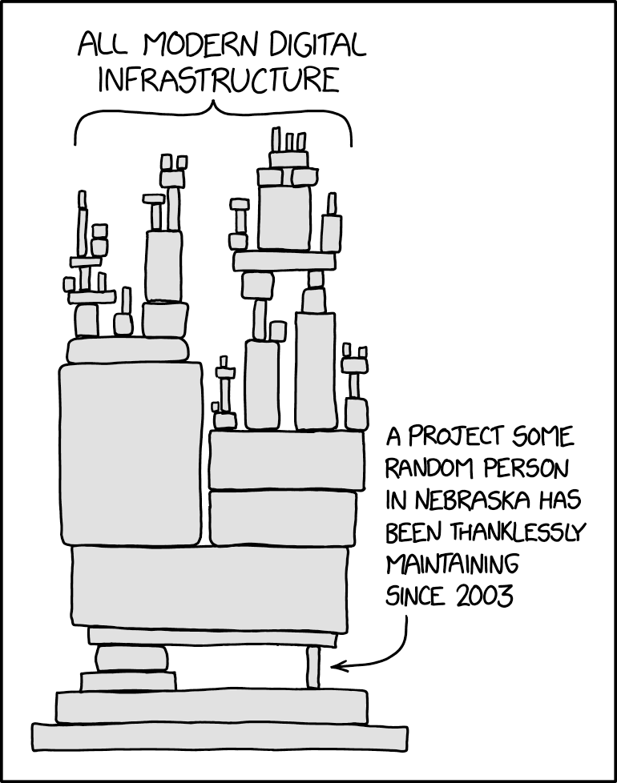
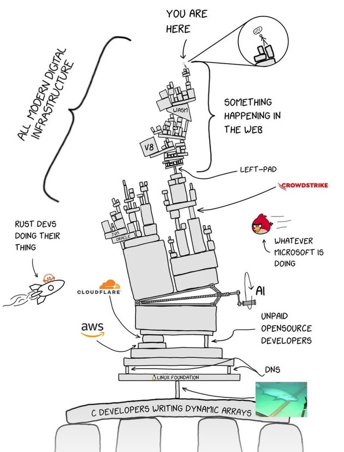
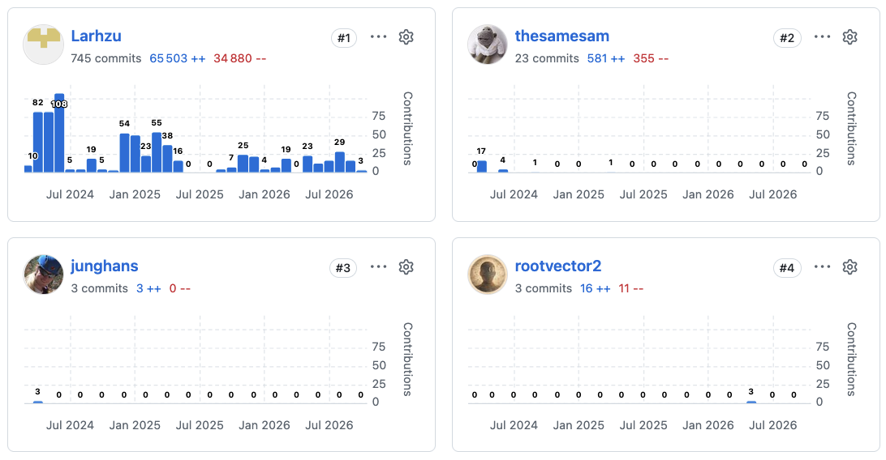

## Definitions

- Open source
- Logiciel libre
- Ouvert
- Propriétaire

## Qui utilise l'open source ?

- Tous les serveurs dans le monde
- Tous les téléphones Android (~75% des téléphones)
- Tous les langages de programmation/packages
- Toutes les technologies autour de l'IA
- VLC, Firefox, Blender...

## Qui décide ?

 

:::: {.columns}
::: {.column width="40%"}

### Big tech

 

- **Google**: Android, Chromium, Tensorflow...
- **Microsoft**: TypeScript, VS Code, ...
- **Meta**: Pytorch, React, ...

Rachat récents:

- **OpenAI**: Astral
- **Anthropic**: Bun
- **IBM**: RedHat
- **CloudFlare**: VoidZero

::: 
::: {.column width="60%"}

### Et les autres

:::
::::

##

## xz utils

 

- Environ ~100 millions d'ordinateur qui l'utilisent
- Collaboration pendant ~2 ans
- CVSS 10
- Un seul maintaineur, **Lasse Colin**
- En 2022: *"I haven't lost interest but my ability to care has been fairly limited mostly due to **longterm mental health issues** but also due to some other things. Recently I've worked off-list a bit with [Jia Tan]{.red} on XZ Utils and perhaps he will have a **bigger role in the future**, we'll see."*

{width="500"}

- Recommendation : *"L'attaque informatique la plus sophistiquée de l'Histoire, Micode"*

## IA et modèles ouverts

## Science et logiciel libre
