## A propos

<br>

:::: {.columns}

::: {.column width="35%"}
{fig-alt="Portrait de Joseph Barbier, souriant et appuyé sur une main." .circle}
<div style="font-size:0.9em;">
   *Joseph*

   <br><br>

   <a href="https://barbierjoseph.com">barbierjoseph.com</a>

   <a href="https://ysunflower.com">ysunflower.com</a>

</div>
:::

::: {.column width="15%"}
:::

::: {.column width="50%"}
<div style="font-size: 1.2em;">
   Consulting

   Open source

   Data(viz)

   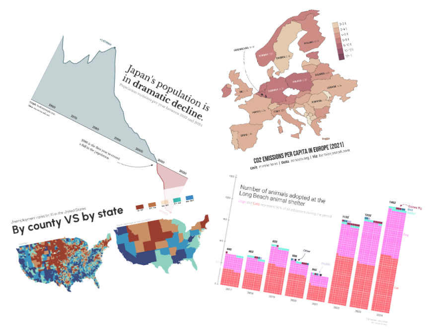{fig-alt="Montage de cartes, de graphiques et d’autres visualisations de données."}
</div>
:::

::::

## Questions

<br>
<br>

<div style="font-size: 1.5em; font-style: italic;">

::: {.fragment .fade-in-then-semi-out}
Qui ne sait pas du tout ce qu'est un package Python ?
:::

<br>

::: {.fragment .fade-in-then-semi-out}
Qui a déjà créé un package Python ?
:::

<br>

::: {.fragment .fade-in-then-semi-out}
Qui contribue à des packages Python open source ?
:::

<br>

::: {.fragment .fade-in-then-semi-out}
Qui a déjà mis sur PyPI un package Python ?
:::

</div>

## TLDR: package Python

```python
def my_super_cool_function(arg):
    if arg == "cool":
        something = 123
    else:
        ...

    ...

    return something
```

:::: {.columns}

::: {.column width="20%"}
:::

::: {.column width="30%"}
{fig-alt="" width=80%}
:::

::: {.column width="50%"}
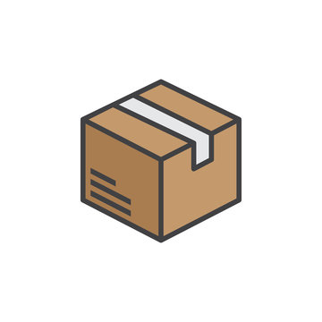{fig-alt="Illustration d’un paquet Python représenté par une boîte en carton." width=60%}
:::

::::

Facilement **distribuable** et donc **reutilisable** !

## Le bon package et le mauvais package

{fig-alt="Mème montrant un homme dans un bar, utilisé pour illustrer la différence entre un bon et un mauvais paquet Python." width=40%}

Un bon package **c'est pas (uniquement) une question de code**.

- facile à installer ?
- facile à comprendre ?
- facile à utiliser ?
- facile à développer ?


## Sommaire

<br>
<br>

### Votre package a besoin de ces 3 choses, <b>la dernière va vous surprendre 😱</b> !

<br>

<div style="font-size: 2em">

- `pyproject.toml` et gestion des dépendances

- Tester dans les meilleures conditions

::: {.blur aria-hidden="true"}
- Créer la meilleure documentation
:::

<span class="sr-only">Le troisième point est masqué sur cette diapositive.</span>

</div>

# Gestion des dépendances

## *one ~~ring~~ **file** to rule them all*

<br>

<div style="font-size: 1.4em;">

Un package ça se décompose en :

- du code Python

- des méta données
    - un nom, une description, des auteur.e.s
    - des dépendances (numpy, pandas, etc)
    - une license
    - ...

</div>

<div style="display: flex; justify-content: center; font-size: 2em;" class="fragment">
✨`pyproject.toml`✨
</div>


## *one ~~ring~~ **file** to rule them all*

<br>

<div style="display: flex; justify-content: center; font-size: 1.7em;">
`pyproject.toml` + [uv](https://docs.astral.sh/uv/) = <3
</div>

<br>

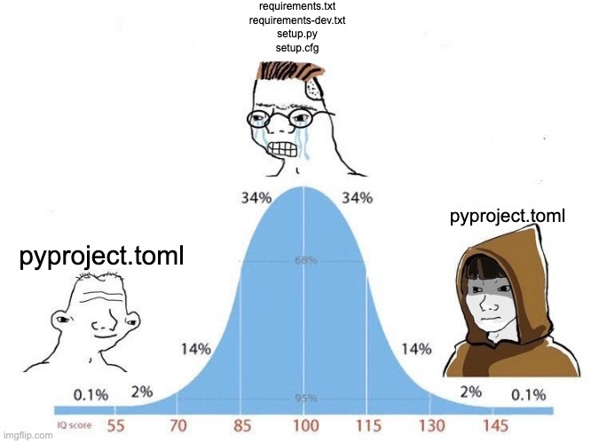{fig-alt="Mème comparant plusieurs façons de configurer un projet Python et présentant pyproject.toml comme le choix central." fig-align="center" width="50%"}

## Gestion des dépendances

<br>

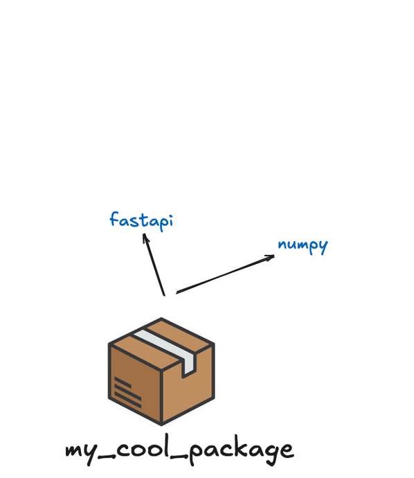{fig-alt="Schéma : le paquet my_cool_package dépend directement de FastAPI et de NumPy." width="50%" fig-align="center"}

## Gestion des dépendances

<br>

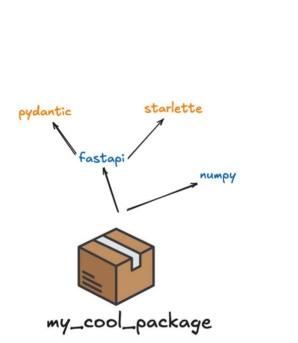{fig-alt="Schéma de dépendances montrant my_cool_package, FastAPI et NumPy, ainsi que Starlette et Pydantic utilisés par FastAPI." width="50%" fig-align="center"}

## Gestion des dépendances

<br>

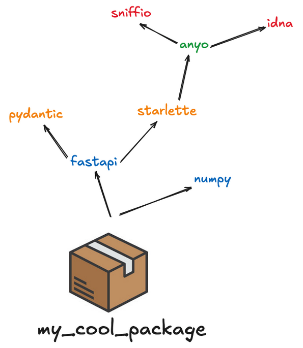{fig-alt="Schéma de dépendances directes et transitives : my_cool_package utilise FastAPI et NumPy; FastAPI entraîne aussi Starlette, Pydantic, AnyIO, Sniffio et Idna." width="50%" fig-align="center"}

## Gestion des dépendances

<br>

:::: {.columns}

::: {.fragment .column width="30%"}

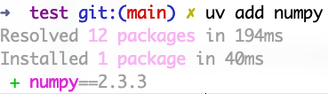{fig-alt="Sortie du terminal après « uv add numpy » : une dépendance est installée et NumPy 2.3.3 est ajouté."}

:::

::: {.fragment .column width="30%"}

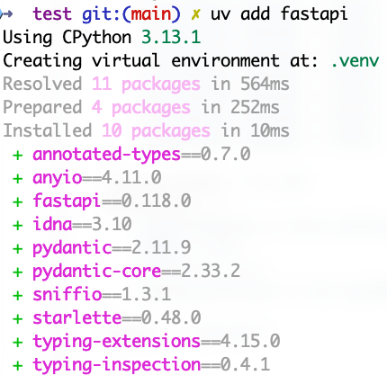{fig-alt="Sortie du terminal après « uv add fastapi » : FastAPI et ses dépendances sont installés dans l’environnement virtuel."}

:::

::: {.fragment .column width="30%"}

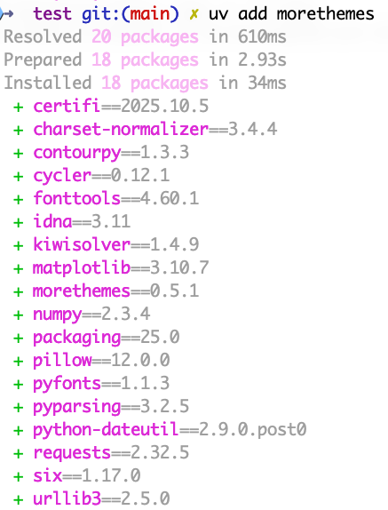{fig-alt="Sortie du terminal après « uv add morethemes » : le résolveur installe les dépendances du paquet morethemes."}

:::

::::

## Gestion des dépendances

<br>

<div style="font-size: 1.4em;">

- open source → être convenient

:::{.fragment}
`numpy>=2.1.0`
:::

<br>
<br>

- closed source → restreindre autant que possible

:::{.fragment}
`numpy==2.1.3`
:::

</div>

# Tester son code

## Tester son code

:::: {.columns}

::: {.column width="30%"}
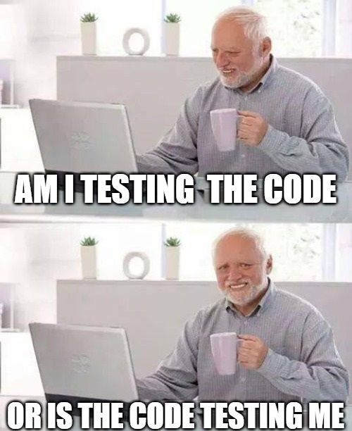{fig-alt="Mème montrant un homme devant un ordinateur avec la question : « Est-ce moi qui teste le code ou le code qui me teste ? »"}
:::

::: {.column width="70%"}
Tester son code ça veut dire quoi ?

- vérifier que le code **n'a pas d'erreur**
- vérifier que le code **fait ce que je pense**
- vérifier que le code **fonctionne dans différents scénarios**
- vérifier que le code **fonctionne dans différents environnements**

<br>

:::{.fragment .fade-in-then-semi-out}
Il suffit de le faire tourner!
:::
:::{.fragment style="color: #9a2515; font-weight: bold; font-size: 1.5em; font-style: italic;"}
Il suffit de le faire tourner?
:::
:::

::::

## Comment (et quoi) tester

:::: {.columns}

::: {.column width="60%"}
- trust yourself
    - ❌ pas d'erreur
    - ❌ fait ce que je pense
    - ❌ différents scénarios
    - ❌ différents environnements
- lancer un exemple d'utilisation
    - ✅ pas d'erreur
    - ❓ fait ce que je pense
    - ❌ différents scénarios
    - ❌ différents environnements
- écrire des tests unitaires
    - ✅ pas d'erreur
    - ✅ fait ce que je pense
    - ✅ différents scénarios
    - ❌ différents environnements
- git push ✅
:::

::: {.column width="40%"}
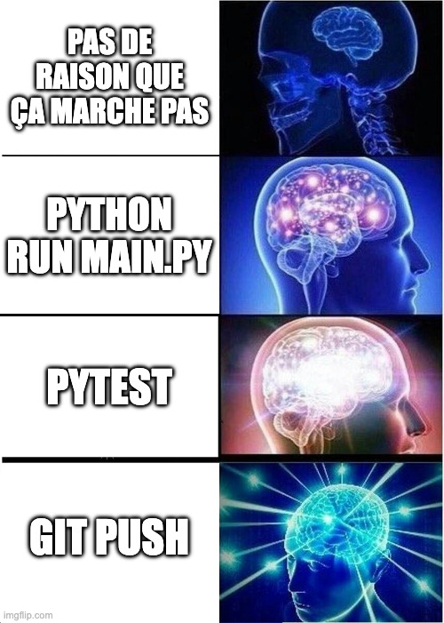{fig-alt="Mème opposant l’intuition « pas de raison que ça ne marche pas » aux vérifications pytest et git push."}
:::

::::

## Github actions

Scrits (yaml) qui se déclenchent dans certaines conditions

- push
- pull requests
- tous les jours à minuit
- ...

<br>

:::{.fragment .fade-in-then-semi-out}
→ faire tourner les tests unitaires
:::

:::{.fragment .fade-in-then-semi-out}
→ sur plusieurs versions de Python (open source ?)
:::

:::{data-id="os" .fragment .fade-in-then-semi-out}
→ sur plusieurs OS
:::

:::{.fragment .fade-in-then-semi-out}
→ **Et cela tout le temps!**
:::

## Github actions

::: {data-id="os" style="margin-top: 100px; font-size: 3em;"}
sur plusieurs OS
:::

## Github actions

::: {data-id="os" style="margin-top: 100px; font-size: 3.2em; color: #9a2515;"}
sur plusieurs OS ???
:::

<br>

:::{.fragment .callout-warning style="font-size: 1.4em;"}
Python est interprété, mais peut se comporter différemment en fonction de l'OS

- noms de fichiers
- chemins
- fichiers temporaires
- permissions
- modules spécifiques
:::

# Documentation

{fig-alt="Public endormi pendant une présentation, pour illustrer une documentation ennuyeuse."}

## Documentation

**La première (et la seule) chose que les gens verronts**

<br>

Pour ça on a besoin de 2 choses:

- Landing page
- Diátaxis framework

## Landing page

<div style="font-size: 1.5em;">

- A quoi sert le package?
- Dans quel contexte il s'inscrit (e.g., package Python)
- Exemple usage minimaliste
- Donner envie!

</div>

## Landing page

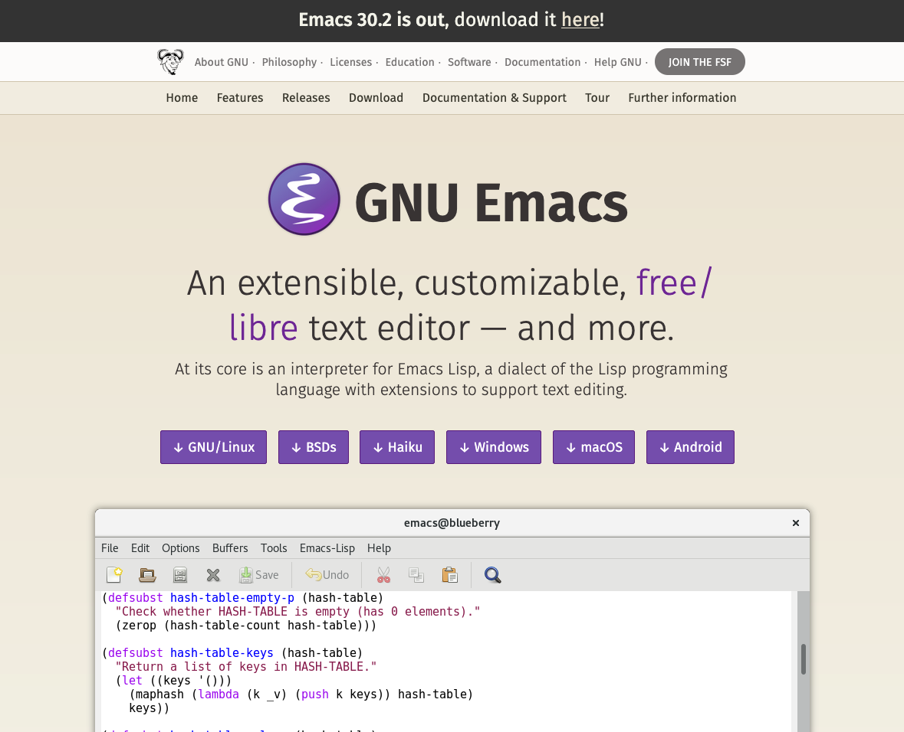{fig-alt="Capture de la page d’accueil de GNU Emacs avec ses liens de téléchargement et sa documentation." width=70% fig-align="center"}

## Landing page

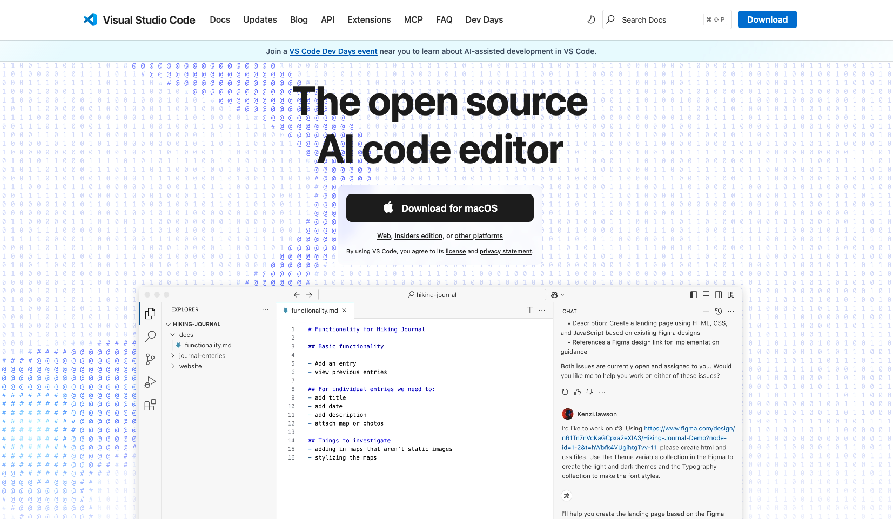{fig-alt="Capture de la page d’accueil de Visual Studio Code, qui présente l’éditeur open source et son bouton de téléchargement."}

## Landing page

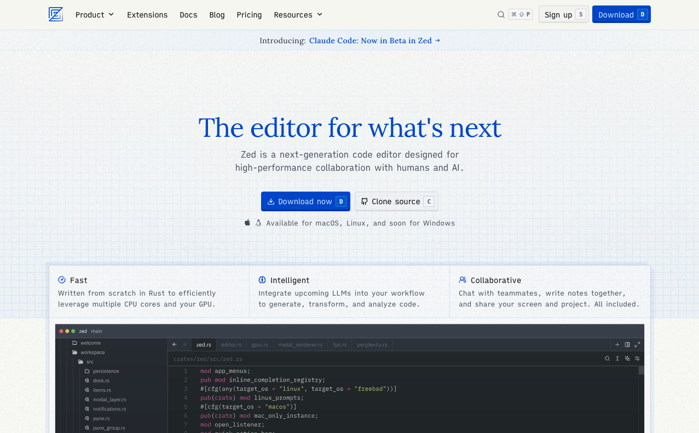{fig-alt="Capture de la page d’accueil de Zed, qui présente l’éditeur et une fenêtre de code."}

## Landing page

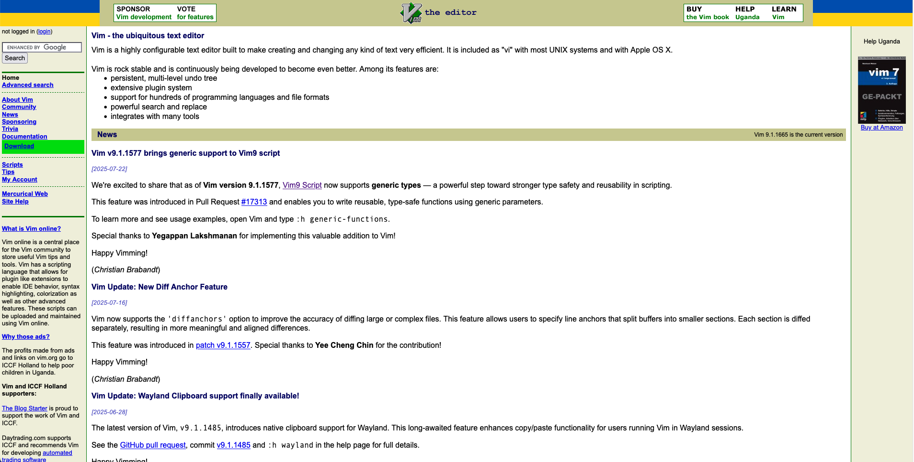{fig-alt="Capture d’écran de l’éditeur Vim et de sa documentation en ligne."}

## Exemple parfait: `plotnine`

<video controls width="100%" aria-label="Enregistrement d’écran muet du site plotnine, présentant une galerie de graphiques et des exemples de figures prêtes à être publiées.">
  <source src="./plotnine.mov" type="video/quicktime" />
</video>
<p class="sr-only">Vidéo sans son du site plotnine : une galerie de visualisations, une page de démarrage et une référence API sont présentées.</p>

## Diátaxis framework (**diataxis.fr**)

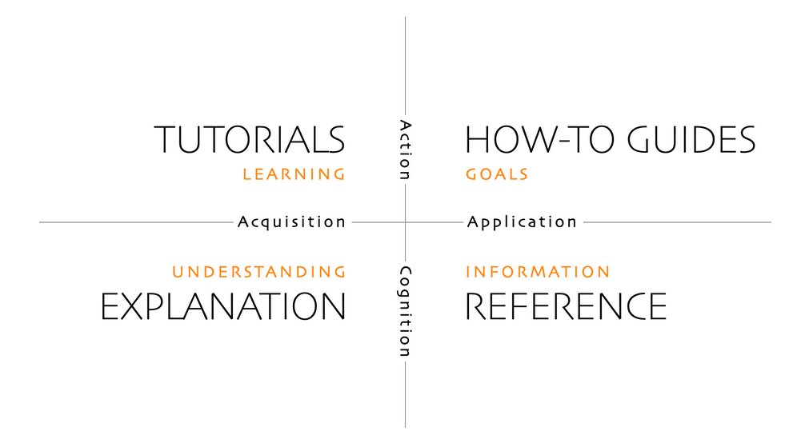{fig-alt="Diagramme de Diátaxis : les tutoriels et guides pratiques soutiennent l’apprentissage et l’action; les explications et références soutiennent la compréhension et l’information."}

## Aller plus loin

<div style="font-size:2em;">

- [github.com/y-sunflower/python-packaging-essentials](https://y-sunflower.github.io/python-packaging-essentials/)
- [github.com/y-sunflower/python-package-template](https://github.com/y-sunflower/python-package-template)

    - des projets open source pour la communauté
    - vous voulez contribuer ? c'est super facile !

</div>

##

<div style="display: flex; justify-content: center; font-size: 3em;">
Merci !
</div>

J'ai dis des choses fausses ?

::: {.nonincremental}
- venez m'en parler !
:::

J'ai dis des choses pertinentes ?

::: {.nonincremental}
- venez m'en parler !
:::

<br>

Autres ?

::: {.nonincremental}
- venez me voir !
- linkedin: Joseph Barbier
- mail: `joseph.barbierdarnal@gmail.com`
- slides: [github.com/JosephBARBIERDARNAL/talk](https://github.com/JosephBARBIERDARNAL/talk/tree/main/src/pycon2025)
:::
