## A propos

<br>

:::: {.columns}

::: {.column width="35%"}
{fig-alt="Portrait de Joseph Barbier, souriant et appuyé sur une main." .circle}
<div style="font-size:0.9em;">
   *Joseph*

   <br><br>

   <a href="https://barbierjoseph.com">barbierjoseph.com</a>

   <a href="https://ysunflower.com">ysunflower.com</a>

</div>
:::

::: {.column width="15%"}
:::

::: {.column width="50%"}
<div style="font-size: 1.2em;">
   
   **Consulting**: data, typst, 

   **Open source**: dataviz, typst, accessibility

   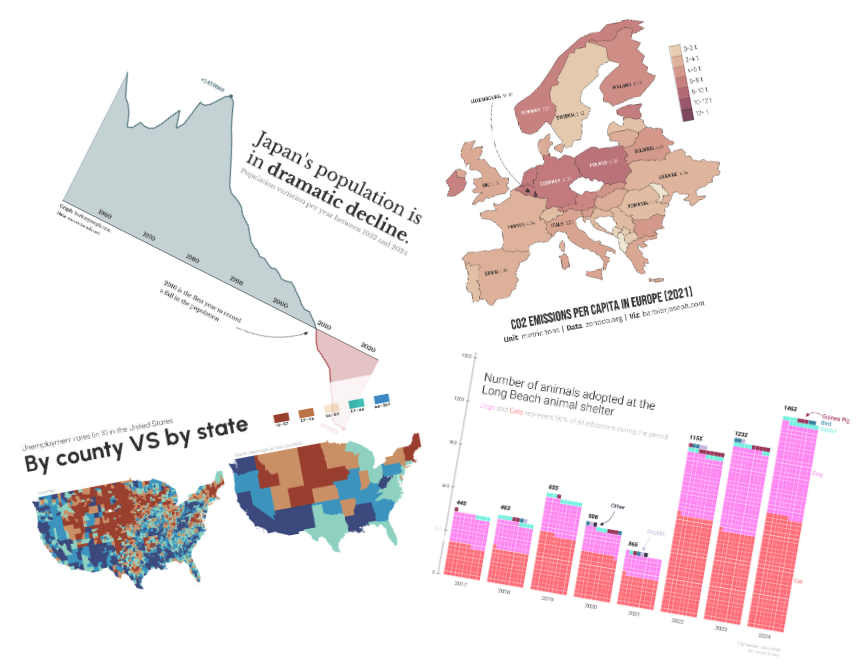{fig-alt="Montage de cartes, de graphiques et d’autres visualisations de données."}
</div>
:::

::::

## Pourquoi venir parler de Rust ?

:::: {.columns}

::: {.column width="60%"}
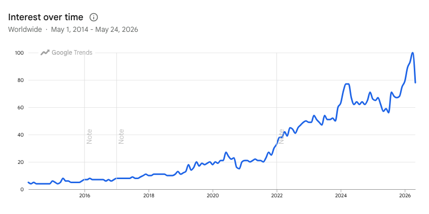
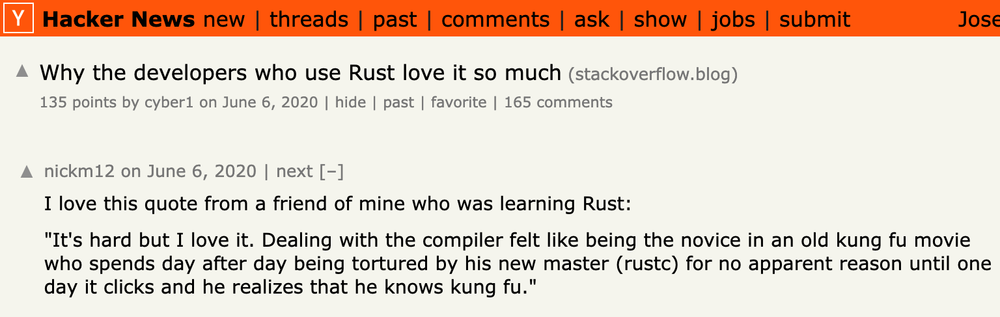
:::


::: {.column width="40%" .nonincremental}
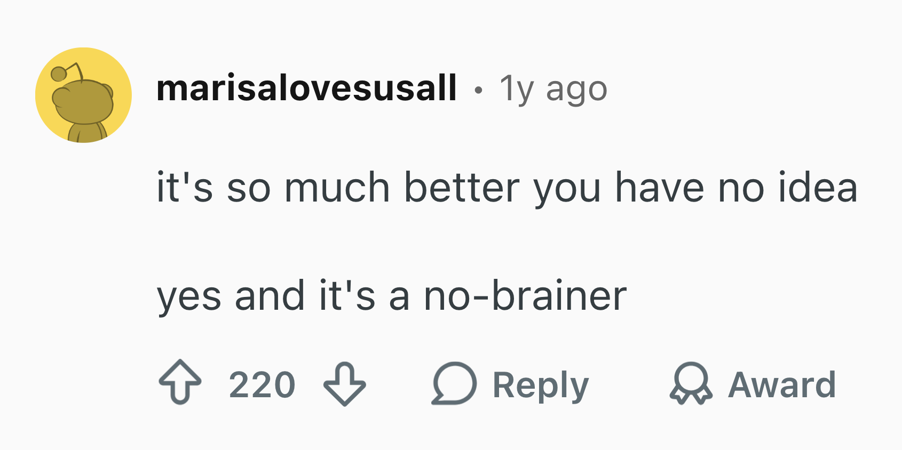

- **Open source**: Linux, Firefox, uv, Deno, bun, ...

- **Industrie**
  - Windows
  - AWS
  - Dropbox
  - Cloudflare
  - Discord
  - Datadog
  - ...

:::
::::

## Langage interprété ou compilé ?

<br>

<center>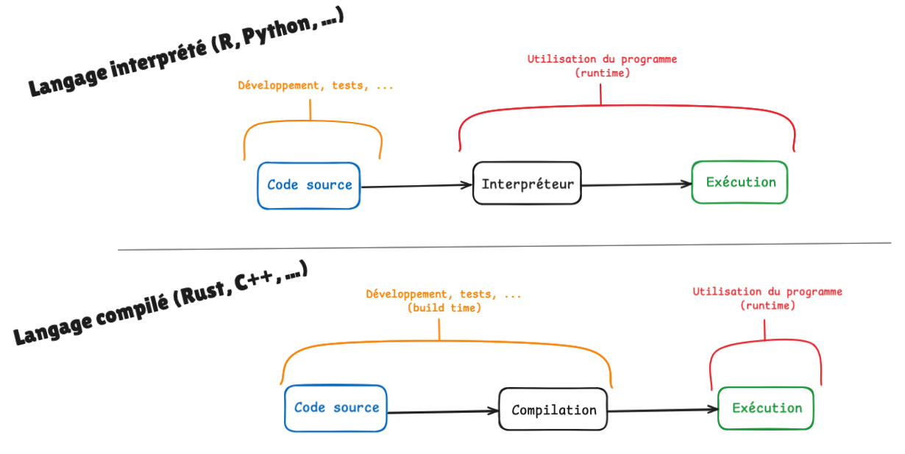</center>

## D'où ça vient ?

<br>
<br>
<br>

- Performance
- Memory safety
- Type safety
- Expérience développeur

## Performance (⚠️⚠️⚠️)

<br>

<center>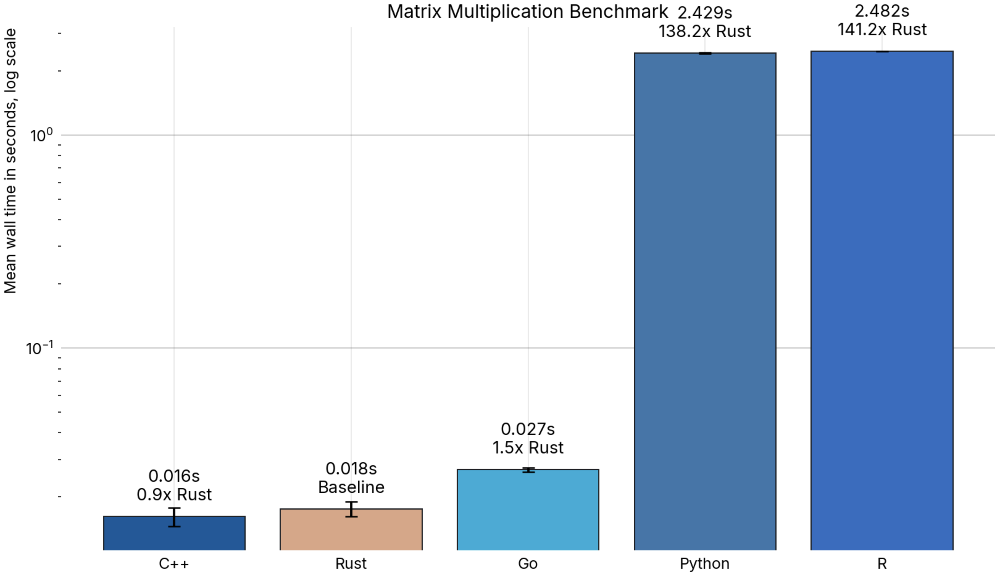</center>


## Memory safety

```{.rs code-line-numbers="|2|3|5-6"}
fn main() {
    let s1 = String::from("hello");
    let s2 = s1;

    println!("{}", s1);
    println!("{}", s2);
}
```

<br>

::: {.fragment}

```{.rs code-line-numbers="1|4-7|9-10|12-15"}
error[E0382]: borrow of moved value: `s1`
 --> /Users/josephbarbier/l/talk/src/pycon2026/script.rs:5:20
  |
2 |     let s1 = String::from("hello");
  |         -- move occurs because `s1` has type `String`, which does not implement the `Copy` trait
3 |     let s2 = s1;
  |              -- value moved here
4 |
5 |     println!("{}", s1);
  |                    ^^ value borrowed here after move
  |
help: consider cloning the value if the performance cost is acceptable
  |
3 |     let s2 = s1.clone();
  |                ++++++++
```

:::

## Type safety

```{.rs code-line-numbers="|2|3|5"}
fn main() {
    let x: i32 = 10;
    let y: &str = "20";

    let result = x + y;
}
```

<br>

::: {.fragment}

```{.rs code-line-numbers="1|4-5|7"}
error[E0277]: cannot add `&str` to `i32`
 --> /Users/josephbarbier/l/talk/src/pycon2026/script2.rs:5:20
  |
5 |     let result = x + y;
  |                    ^ no implementation for `i32 + &str`
  |
  = help: the trait `Add<&str>` is not implemented for `i32`
  = help: the following other types implement trait `Add<Rhs>`:
            `&i32` implements `Add<i32>`
            `&i32` implements `Add`
            `i32` implements `Add<&i32>`
            `i32` implements `Add`
```

:::

<br>
<br>

- *"Oui mais en Python aussi j'aurai une erreur"*


## Expérience développeur

- Formatter? `rustfmt`
- Linter? `clippy`
- LSP? `rust-analyzer`
- Package management? `cargo`
- Testing? `cargo test`
- Documentation? `rustdoc`

<video controls muted width="65%" aria-label="Enregistrement d’écran muet montrant un éditeur de code avec un fichier Rust et la définition d’une fonction qui construit un moteur Typst.">
  <source src="./rust-usage.mp4" type="video/mp4">
</video>
<p class="sr-only">La vidéo montre un fichier Rust ouvert dans un éditeur, avec des imports et une fonction de construction d’un moteur Typst.</p>

## Ecosystème Python

::: {.nonincremental .ecosystem-list}

- `uv`/`pixi`: package/project manager
- `ruff`: linter & formatter
- `ty`/`pyrefly`: type checker
- `polars`: data manipulation
- `pydantic`: data validation
- `monty`: interpreter
- `prek`: pre-commit hook
- **et plein d'autres!**

:::

## Demo intégration rust<->python

<br>
<br>
<br>

<center>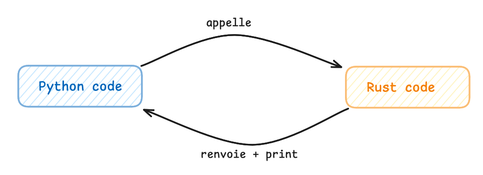</center>

## Vibe coding et Rust

<br>

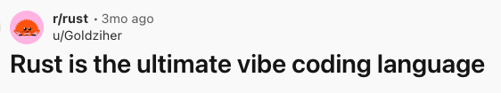

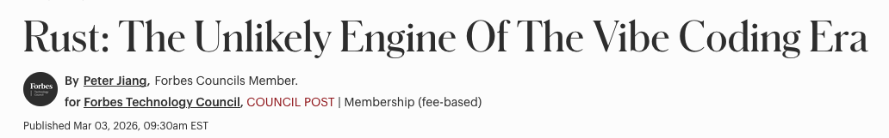

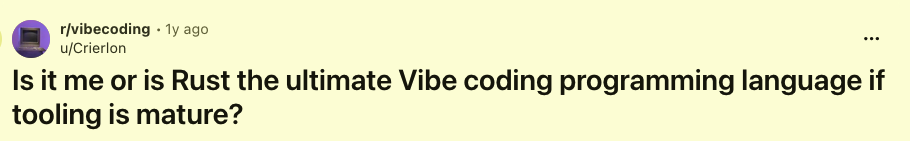

## Commencer Rust

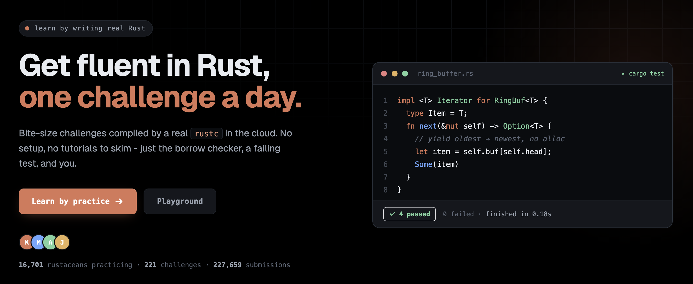{fig-alt="Capture du site Rust in One Day, qui propose un exercice de code quotidien pour progresser en Rust." width="800"}

- Bindings / rewrite
- Contribution open source

## Un mot sur l'IA et l'apprentissage

<center>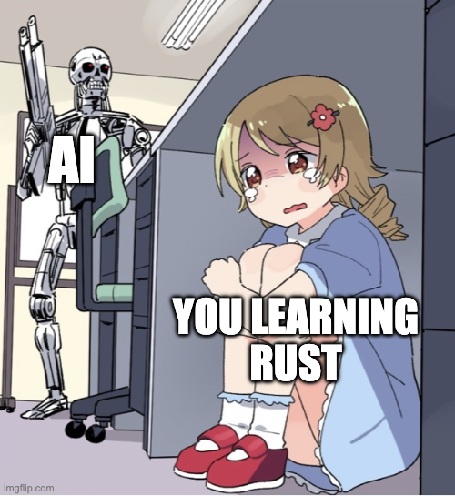</center>

##

<div style="display: flex; justify-content: center; font-size: 3em;">
Merci !
</div>

Vous voulez en savoir plus ?


::: {.nonincremental}
- venez discuter !
- linkedin: Joseph Barbier
- mail: `joseph@ysunflower.com`
- slides: [github.com/josephbarbierdarnal/talk](https://github.com/JosephBARBIERDARNAL/talk/tree/main/src/rencontresR2026)
:::

<center></center>
