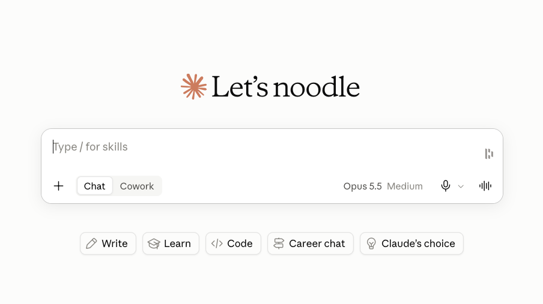
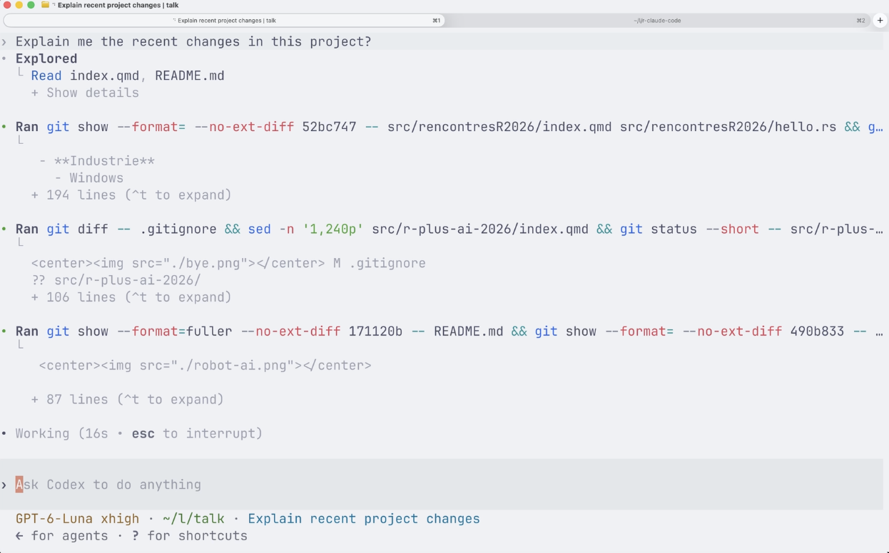
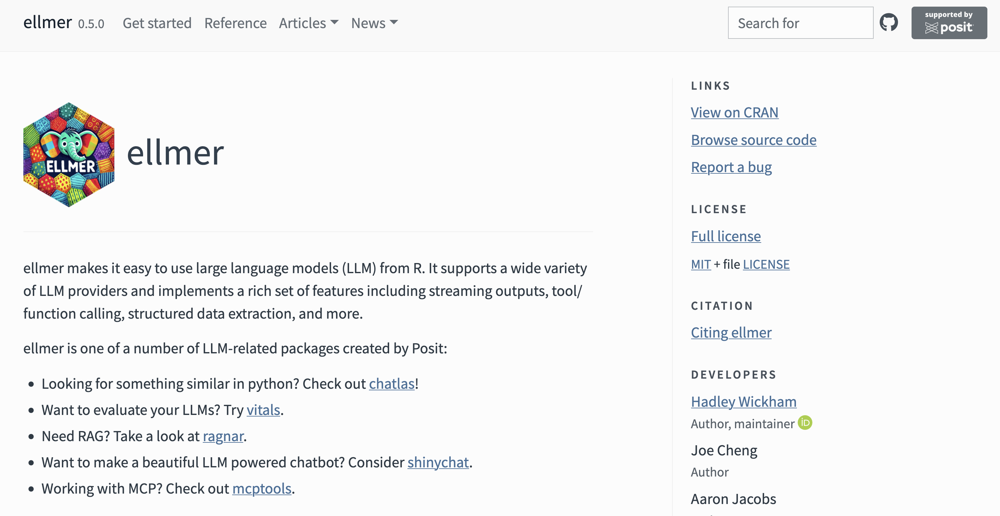

## About

<br>

:::: {.columns}

::: {.column width="35%"}
{.circle}
<div style="font-size:0.9em;">
   *Joseph*

   <br><br>

   <a href="https://barbierjoseph.com">barbierjoseph.com</a>

   <a href="https://ysunflower.com">ysunflower.com</a>

</div>
:::

::: {.column width="15%"}
:::

::: {.column width="50%"}
<div style="font-size: 1.2em;">
   
   **Consulting**: data, Typst

   **Open source**: dataviz, Typst, accessibility

   
</div>
:::

::::

## Web app

:::: {.columns}

::: {.column width="50%"}

:::

::: {.column width="50%"}

:::

::::

<br>

- we forget important details
- we ignore things that could be relevant
- we need to copy-paste lots of code
- we're lazy

## TUI (Terminal User Interface)

- [where many devs already work]{.green}
- [no browser limitations (e.g., file access)]{.green}
- [faster]{.green}
- [doesn't look as good]{.red}

<center></center>

## TUI

<br>

They are written in [Rust]{.rust} (Codex) or [TypeScript]{.typescript} (Claude Code, OpenCode, Pi)

<br>
<br>
<br>
<br>
<br>
<br>

<center style="font-size: 3rem; font-style:italic;">How about R?</center>

## **LLM** VS **chatbot** VS **agent** 

<br>
<br>

### Definitions

<div class="incremental">

- **LLM** = A model that takes text input and generates text output
- **Chatbot** = A conversational interface built around an LLM, where previous messages are included in the context of each new request
- **Agent** = An AI system that can use tools (APIs, browsers, code execution, etc.) to perform actions

<br>
<br>
<br>

### How can we create that in R?

- ✅ **LLM** = any AI API can work: OpenAI, Claude, Ollama, etc.
- ⚠️ **Chatbot** = an R console can do the work
- ❌ **Agent** = [that's what we need to build]{.red}

</div>

## 

<center></center>

## Chatbot {auto-animate="true"}

<br>
<br>
<br>
<br>

```R
library(ellmer)

chat <- chat_anthropic()
live_console(chat)
```

## Claude Code's key tools

<br>
<br>
<br>

- [ ] List files 
- [ ] Read files
- [ ] Write files
- [ ] Run commands

## Agent = chat with tools {auto-animate="true"}

<br>

```{.r code-line-numbers="|3-8|4|5|6|7|11"}
library(ellmer)

list_files <- tool(
  function(path = ".") list.files(path, recursive = TRUE, all.files = TRUE, no.. = TRUE),
  name = "list_files",
  description = "List files under a directory.",
  arguments = list(path = type_string("Directory to list.", required = FALSE))
)

chat <- chat_anthropic()
chat$register_tool(list_files)

live_console(chat)
```

## Claude Code's key tools

- [x] List files 
- [ ] Read files
- [ ] Write files
- [ ] Run commands

<br>
<br>
<br>

<center style="font-size:2.5rem;">Next: **read a file**</center>

## Read files

<br>
<br>
<br>
<br>

```{.r code-line-numbers="|2|3|4|5"}
read_file <- tool(
  function(path) paste(readLines(path, warn = FALSE), collapse = "\n"),
  name = "read_file",
  description = "Read a text file.",
  arguments = list(path = type_string("Path to the text file to read."))
)
```

## Claude Code's key tools

- [x] List files 
- [x] Read files
- [ ] Write files
- [ ] Run commands

<br>
<br>
<br>

<center style="font-size:2.5rem;">Next: **write a file**</center>

## Write files

<br>
<br>

```{.r code-line-numbers="1|4-8|5|6|7|9|10|4,11-14"}
ask <- \(x) isTRUE(utils::askYesNo(x))

write_file <- tool(
  function(path, text) {
    if (!ask(sprintf("Write %s?", path))) tool_reject()
    writeLines(text, path)
    sprintf("Wrote %s", path)
  },
  name = "write_file",
  description = "Write text to a file.",
  arguments = list(
    path = type_string("Path to write."),
    text = type_string("Full text content to write.")
  )
)
```

## Claude Code's key tools

- [x] List files 
- [x] Read files
- [x] Write files
- [ ] Run commands

<br>
<br>
<br>

<center style="font-size:2.5rem;">Next: **run commands**</center>

## Write files

<br>
<br>

```{.r code-line-numbers="5-9|6|7|2,8|10|11|12"}
ask <- \(x) isTRUE(utils::askYesNo(x))
`%||%` <- \(x, y) if (is.null(x)) y else x

run_shell <- tool(
  function(command) {
    if (!ask(sprintf("Run `%s`?", command))) tool_reject()
    out <- suppressWarnings(system2("sh", c("-c", command), stdout = TRUE, stderr = TRUE))
    paste(c(sprintf("exit status: %s", attr(out, "status") %||% 0L), out), collapse = "\n")
  },
  name = "run_shell",
  description = "Run a shell command and return its output.",
  arguments = list(command = type_string("Shell command to run."))
)
```

## Claude Code's key tools

```r
library(ellmer)

`%||%` <- \(x, y) if (is.null(x)) y else x
ask <- \(x) isTRUE(utils::askYesNo(x))

list_files <- tool(
  function(path = ".") list.files(path, recursive = TRUE, all.files = TRUE, no.. = TRUE),
  name = "list_files",
  description = "List files under a directory.",
  arguments = list(path = type_string("Directory to list.", required = FALSE))
)

read_file <- tool(
  function(path) paste(readLines(path, warn = FALSE), collapse = "\n"),
  name = "read_file",
  description = "Read a text file.",
  arguments = list(path = type_string("Path to the text file to read."))
)

write_file <- tool(
  function(path, text) {
    if (!ask(sprintf("Write %s?", path))) tool_reject()
    writeLines(text, path)
    sprintf("Wrote %s", path)
  },
  name = "write_file",
  description = "Write text to a file.",
  arguments = list(
    path = type_string("Path to write."),
    text = type_string("Full text content to write.")
  )
)

run_shell <- tool(
  function(command) {
    if (!ask(sprintf("Run `%s`?", command))) tool_reject()
    out <- suppressWarnings(system2("sh", c("-c", command), stdout = TRUE, stderr = TRUE))
    paste(c(sprintf("exit status: %s", attr(out, "status") %||% 0L), out), collapse = "\n")
  },
  name = "run_shell",
  description = "Run a shell command and return its output.",
  arguments = list(command = type_string("Shell command to run."))
)

chat <- chat_anthropic()
chat$register_tools(list(list_files, read_file, write_file, run_shell))
live_console(chat)
```

<br>
<br>

**47 lines of R code** for an Agent that can list/read/modify files and run commands

## Ending notes

<br>

⚠️ [This isn't a viable replacement!]{.red}

<br>
<br>

Want to learn more? Implement missing features yourself!

- read CLAUDE.md
- security guardrails
- nicer UI
- ...

<br>

<center><b>Code: [github.com/josephbarbierdarnal/r-claude-code](https://github.com/JosephBARBIERDARNAL/r-claude-code)</b></center>

##

<div style="display: flex; justify-content: center; font-size: 3em;">
Thanks!
</div>

Want to know more?


::: {.nonincremental}
- let's chat!
- LinkedIn: Joseph Barbier
- email: `joseph@ysunflower.com`
- slides: [github.com/josephbarbierdarnal/talk](https://github.com/JosephBARBIERDARNAL/talk/tree/main/src/rencontresR2026)
:::

<center></center>
