## Pourquoi venir parler de Rust ?

<br>

<center></center>

## Pourquoi venir parler de Rust ?

:::: {.columns}

::: {.column width="60%"}
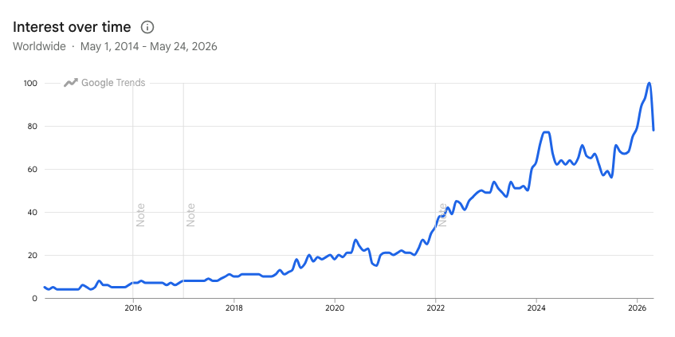
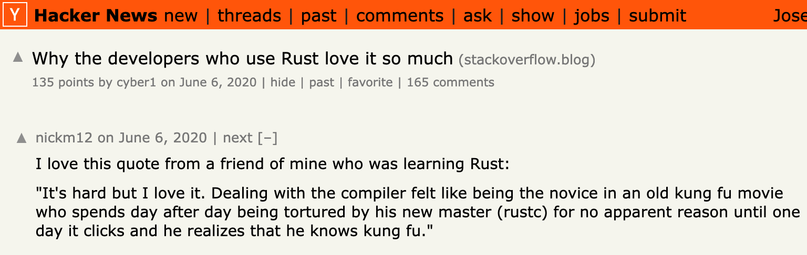
:::


::: {.column width="40%" .nonincremental}
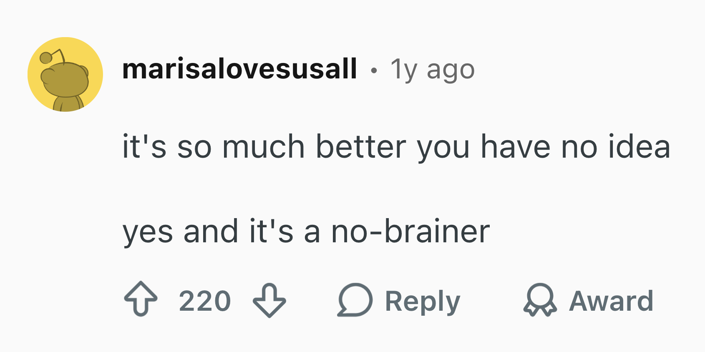

- **Open source**: Linux, Firefox, uv, Deno, bun, ...

- **Industrie**
  - Windows
  - AWS
  - Dropbox
  - Cloudflare
  - Discord
  - Datadog
  - ...

:::
::::

## Pourquoi venir parler de Rust ?

::: {.why-rust-points .nonincremental}

- **Pas** pour vous dire que c'est mieux que R
- Pour comprendre les outils qu'on utilise
- Pour vous donner envie d'essayer

:::

## Langage interprété ou compilé ?

<br>

<center>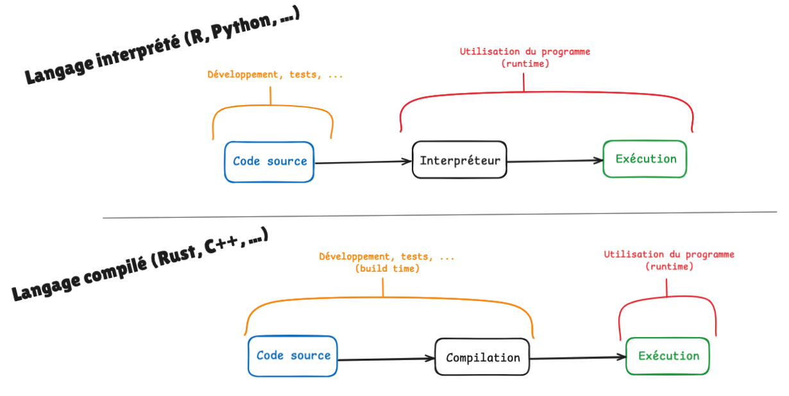</center>

# D'où ça vient ?

## Performance (⚠️⚠️⚠️)

<br>

<center>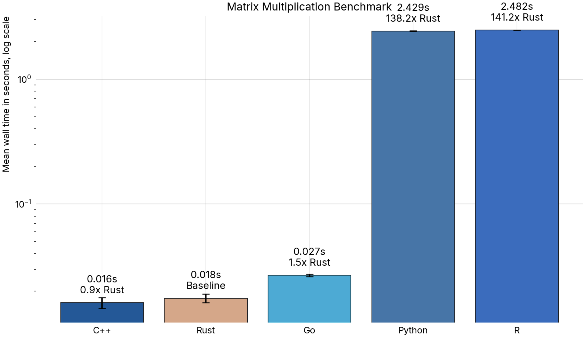</center>


## Memory safety

```{.rs code-line-numbers="|2|3|5-6"}
fn main() {
    let s1 = String::from("hello");
    let s2 = s1;

    println!("{}", s1);
    println!("{}", s2);
}
```

<br>

::: {.fragment}

```rs
error[E0382]: borrow of moved value: `s1`
 --> /Users/josephbarbier/l/talk/src/rencontresR2026/script.rs:5:20
  |
2 |     let s1 = String::from("hello");
  |         -- move occurs because `s1` has type `String`, which does not implement the `Copy` trait
3 |     let s2 = s1;
  |              -- value moved here
4 |
5 |     println!("{}", s1);
  |                    ^^ value borrowed here after move
  |
help: consider cloning the value if the performance cost is acceptable
  |
3 |     let s2 = s1.clone();
  |                ++++++++
```

:::

## Type safety

```{.rs code-line-numbers="|2|3|5"}
fn main() {
    let x: i32 = 10;
    let y: &str = "20";

    let result = x + y;
}
```

<br>

::: {.fragment}

```rs
error[E0277]: cannot add `&str` to `i32`
 --> /Users/josephbarbier/l/talk/src/rencontresR2026/script2.rs:5:20
  |
5 |     let result = x + y;
  |                    ^ no implementation for `i32 + &str`
  |
  = help: the trait `Add<&str>` is not implemented for `i32`
  = help: the following other types implement trait `Add<Rhs>`:
            `&i32` implements `Add<i32>`
            `&i32` implements `Add`
            `i32` implements `Add<&i32>`
            `i32` implements `Add`
```

:::

<br>
<br>

- *"Oui mais en R aussi j'aurai une erreur"*


## Expérience développeur

<video controls muted aria-label="Enregistrement d’écran muet montrant un éditeur de code avec un fichier Rust et la définition d’une fonction qui construit un moteur Typst.">
  <source src="./rust-usage.mp4" type="video/mp4">
</video>
<p class="sr-only">La vidéo montre un fichier Rust ouvert dans un éditeur, avec des imports et une fonction de construction d’un moteur Typst.</p>

## Ecosystème Python

::: {.nonincremental .ecosystem-list}

- `uv`: package/project manager
- `ruff`: linter & formatter
- `ty`: type checker
- `pyrefly`: type checker
- `polars`: data manipulation
- `pydantic`: data validation
- `monty`: interpreter
- `prek`: pre-commit hook
- **et plein d'autres!**

:::

# R ❤️ Rust : ça existe déjà<br>(et ça marche)

## Rust dans l'écosystème R

::: {.nonincremental .ecosystem-list}

- `Ark`: kernel R (utilisé dans Positron IDE)
- `Air`: formatter et serveur de langage
- `Jarl`: linter
- `yaml12`: YAML parser
- `polars`: R interface à polars
- **et plein d'autres !**

:::

## Projet en développement

<br>
<br>
<br>

:::: {.project-grid .nonincremental}

::: {.project-card}

<div class="project-title"><code>q2</code></div>

<div class="project-description">Quarto version 2</div>

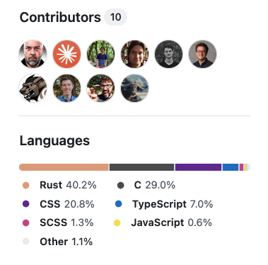{fig-alt="Statistiques de langages d’un dépôt GitHub : Rust 40,2 %, C 29 %, CSS 20,8 % et TypeScript 7 %; le dépôt compte dix contributeurs."}

:::

::: {.project-card}

<div class="project-title"><code>rv</code></div>

<div class="project-description">Gestion des dépendances et paquets R</div>

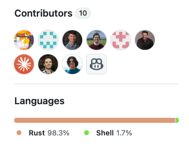{fig-alt="Statistiques d’un dépôt GitHub dominé par Rust, avec 98,3 % de code Rust et 1,7 % de Shell."}

:::

::: {.project-card}

<div class="project-title"><code>ggsql</code></div>

<div class="project-description">Grammaire des graphiques et SQL</div>

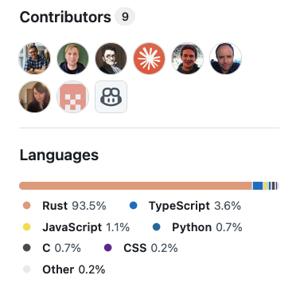{fig-alt="Statistiques de langages d’un dépôt GitHub : R 38,3 %, C 31,4 % et Fortran 23,6 %."}

:::

::::

## Appeler Rust depuis R : `extendr`

<center >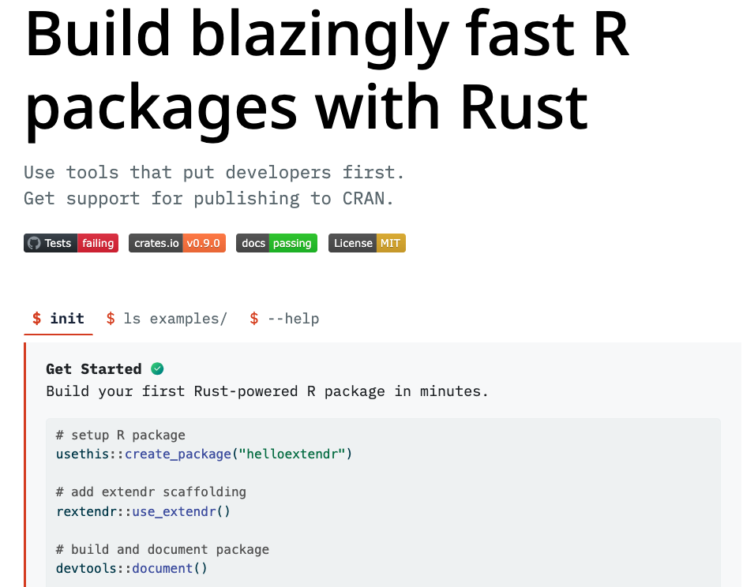</center>

## 

<br>


```{.rs code-line-numbers="|1|3-7|9-12"}
use extendr_api::prelude::*;

/// @export
#[extendr]
fn hello() -> &'static str {
    "Hello RencontresR 2026 !"
}

extendr_module! {
    mod helloextendr;
    fn hello;
}
```

<br>

::: {.fragment}

```{.r code-line-numbers="1-2|4-5"}
devtools::document() # build package
devtools::load_all() # load package

hello()
#> "Hello RencontresR 2026 !"
```

:::


## Est-ce que je dois arrêter R pour faire du Rust ?

<br>

:::: {.columns}

::: {.column width="50%"}
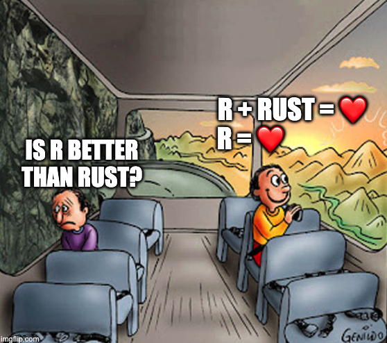
:::

::: {.column width="50%"}
- Rust ne remplace(ra) pas R
- Rust fonctionne **avec R**
- Rust <u>peut</u> remplacer C/C++
:::
::::

## Un mot sur l'IA

<center>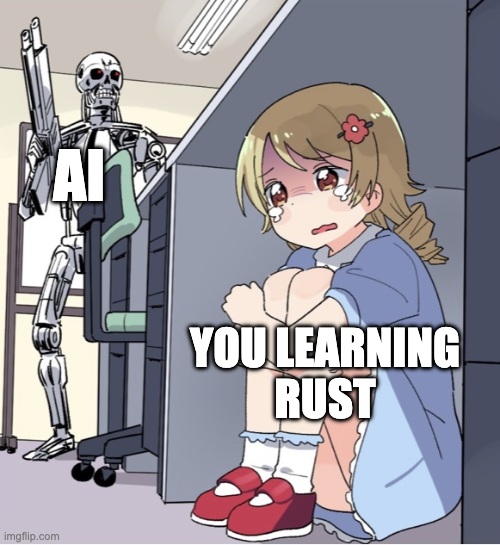</center>

##

<div style="display: flex; justify-content: center; font-size: 3em;">
Merci !
</div>

Vous voulez en savoir plus ?


::: {.nonincremental}
- venez discuter !
- linkedin: Joseph Barbier
- mail: `joseph@ysunflower.com`
- slides: [github.com/josephbarbierdarnal/talk](https://github.com/JosephBARBIERDARNAL/talk/tree/main/src/rencontresR2026)
:::

<center></center>
